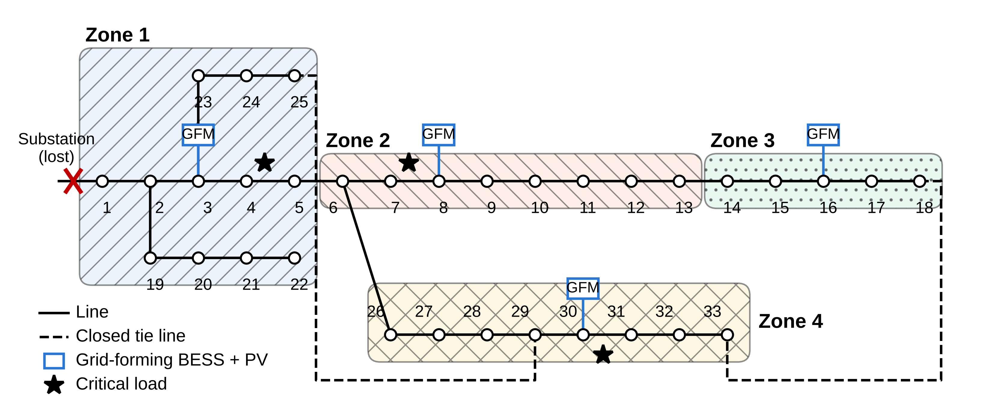
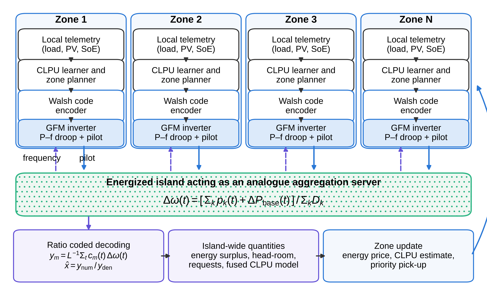

# OTG-FR: Grid Frequency as the Aggregation Channel for Federated Restoration of Islanded Microgrids

**Repository:** https://github.com/iitrky/otg-fr

Complete code, data, figures and manuscript for the article

> **Grid Frequency as the Aggregation Channel for Federated Restoration of Islanded Microgrids**
> Arul Dalton G\* and Marisargunam S
> Saveetha Engineering College, Chennai, India
> \*Correspondence: aruldalton@saveetha.ac.in

| Author | Affiliation | ORCID |
|---|---|---|
| Arul Dalton G (corresponding) | Department of Computer Science and Engineering, Saveetha Engineering College, Chennai, India | [0000-0002-5981-7176](https://orcid.org/0000-0002-5981-7176) |
| Marisargunam S | Department of Electrical and Electronics Engineering, Saveetha Engineering College, Chennai, India | [0009-0008-5157-2048](https://orcid.org/0009-0008-5157-2048) |

---

## Idea

After disasters, distribution feeders are restored as islands energized by batteries and solar, while the telecommunication networks that coordinate those islands fail in the same event. In an island held by grid-forming inverters, the droop steady-state frequency is a stiffness-weighted **sum** of all inverter power set-points:

$$\Delta\omega=\frac{\sum_k P_k^{\mathrm{set}}+P_{\mathrm{PV}}-P_{\mathrm{L}}-P_{\mathrm{loss}}}{\sum_k D_k}$$

The power network therefore *computes* the aggregates that federated learning needs. Two algorithms use this:

| | Algorithm | Code |
|---|---|---|
| **Algorithm 1** | **OTG-FR**: over-the-grid federated restoration. Zones learn cold-load pick-up, fuse it federatively, agree an island-wide energy price and restore loads by priority. | [`otgfr/restoration.py`](otgfr/restoration.py) |
| **Algorithm 2** | **RCD**: ratio-coded droop aggregation. Each zone adds Walsh-coded power pilots and decodes island-wide weighted averages from its own frequency as a ratio of code correlations, which is invariant to the unknown network and droop gains. | [`otgfr/rcd.py`](otgfr/rcd.py) |
| | Islanded IEEE 33-bus droop AC power flow (Newton, analytic Jacobian) | [`otgfr/network.py`](otgfr/network.py) |





## Main results (v2.0; 100 closed-loop 24-h restorations)

| Method | Telecom | Priority-weighted energy (% of full information) | Critical load served | Re-interruptions per day |
|---|---|---|---|---|
| Local planning, rating droop | none | 74.3 % | 82.0 % | 19.5 |
| Local planning, SoC-adaptive droop | none | 78.8 % | 88.5 % | 18.8 |
| Same federated algorithm over telecom, availability 0.9 | 90 % | 88.9 % | 91.8 % | 20.6 |
| **OTG-FR (proposed)** | **none** | **96.5 %** | **99.95 %** | **9.6** |

* Theory (manuscript Section 3.3): ratio decoding is exact for any unknown stiffness; drift-ordered Walsh codes cancel
  polynomial load/PV ramps up to degree 4; a closed-form decoding-error law matches simulation within 9 %.
* Against time-slotted power talk with unknown droop stiffness, the decoding error in AC power flow is 0.041 versus 0.246.
* OTG-FR beats local SoC droop in 100 of 100 paired scenarios (Holm-adjusted p < 1e-15). See `CHANGES.md` for v2.0.

## Quick start

Requirements: Python ≥ 3.9 (NumPy, SciPy, Matplotlib, pandapower, pytest); `pandoc` only for rebuilding the Word documents.

```bash
git clone https://github.com/iitrky/otg-fr.git
```

```bash
cd otg-fr
```

```bash
pip install -r requirements.txt
```

```bash
sh run_all.sh
```

`run_all.sh` runs the 12 tests and the eight experiments, then regenerates every figure, the Word documents and the anonymized supplementary archive (about 20 minutes on 2 CPU cores). All random streams are seeded, so every number is reproduced exactly.

Use the package directly:

```python
from otgfr.restoration import make_scenario, run
scn = make_scenario(0)
otg = run(scn, "otg")          # Algorithm 1 with Algorithm 2 over the grid channel
loc = run(scn, "local_soc")    # communication-free baseline
print(otg["crit_frac"], loc["crit_frac"])
```

```python
import numpy as np
from otgfr.rcd import RCDChannel
ch = RCDChannel([("mean", 1.0, False), ("wavg", 1.0, True)], length=128, amplitude_mw=0.006)
x, w = np.array([0.2, -0.4, 0.6]), np.array([1.0, 0.5, 0.2])
Z = ch.contributions(dict(mean=x, wavg=x), dict(wavg=w), dict(wavg=1.0))
dw = ch.pilot_powers(Z).sum(0) / 123.4       # the network sums pilots; the stiffness is unknown to the zones
print(ch.decode(dw)[0])                       # exact mean and weighted mean
```

## Repository layout

```
otgfr/                      Python package
  network.py                islanded IEEE 33-bus feeder, zones, DER data, droop AC power flow
  rcd.py                    Algorithm 2 - Walsh codes, encoder, ratio decoder, channel model, DP accounting
  restoration.py            Algorithm 1 - CLPU learner, zone planner, price negotiation, physics, baselines
experiments/
  exp1_channel_validation.py   chip-by-chip AC power-flow validation        (Tables 5-6, Fig. 3)
  exp2_time_domain.py          small-signal inverter dynamics, chip sweep   (Table 7, Fig. 3c)
  exp3_restoration.py          100-scenario closed-loop Monte Carlo         (Tables 8-9, Figs 4-6)
  exp4_scaling_robustness.py   N-scaling, inverter trip, privacy            (Fig. 6c)
  make_figures.py              Fig1-Fig6 (PNG, PDF, 600 dpi TIFF; journal artwork rules)
tests/                      11 pytest tests (power flow, decoding invariance, end-to-end)
results/                    JSON results, logs, figures/
manuscript/
  Research_Paper_Complete.docx   complete paper with authors (Word)
  Manuscript_anonymized.docx     double-blind manuscript (Word)
  Title_Page.docx                title page with authors, ORCID and declarations (Word)
  Cover_Letter.docx              cover letter to the Editor-in-Chief (Word)
  Manuscript_preview.pdf         PDF preview
  manuscript.md, title_page.md, cover_letter.md   sources;  references.py: APA 7 references (Crossref-verified)
  build.py                       builds all Word documents and submission/
  submission/                    journal upload set (manuscript, title page, Fig1-Fig6.tif, ESM_1.zip)
docs/IMPLEMENTATION.md      equation-to-code map, parameters, experiment design, extension guide
make_esm.sh                 builds the anonymized Online Resource 1 (ESM_1.zip)
run_all.sh                  reproduces everything
```

## Documentation

[`docs/IMPLEMENTATION.md`](docs/IMPLEMENTATION.md) maps every equation and algorithm line to the code. It also lists every parameter, describes how each experiment is built and explains how to apply the method to another feeder or another federated task.

## Scope and limitations

All evidence is computational: AC power flow, small-signal inverter dynamics and a closed-loop Monte Carlo study. Hardware-in-the-loop validation is future work. The open issues are re-interruptions (39 per day, versus 1.8 for the full-information coordinator), formal differential privacy and robustness to adversarial zones. See `docs/IMPLEMENTATION.md` §9.

## Citation and licence

Cite using [`CITATION.cff`](CITATION.cff) (GitHub's "Cite this repository" button). Released under the MIT licence ([`LICENSE`](LICENSE)).
