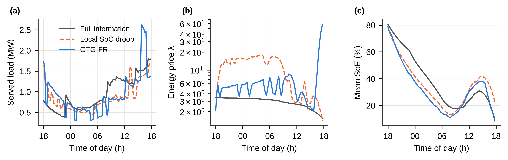

# Abstract {.unnumbered}

When a storm takes down the bulk grid, parts of a distribution feeder can be kept alive as islands supplied by local batteries and solar panels, but the same storm often cuts the links that coordinate them. We show that the island does not need those links. Inverters running in grid-forming mode with frequency droop settle to one frequency that is a weighted sum of every inverter's power set-point, so the network performs the averaging step of federated learning and price coordination. In ratio-coded droop aggregation, each zone adds a few kilowatts of Walsh-coded pilot power to its set-point and recovers island-wide weighted averages from its own frequency as the ratio of two code correlations. We prove that the ratio is exact for any unknown droop stiffness and that ordering codes by polynomial drift order cancels load and solar ramps up to fourth degree, and we derive a decoding-error law that matches simulation to within 9%. An over-the-grid restoration algorithm with price averaging uses this channel to learn cold-load pick-up, pool it and agree on an energy price without any communication link. On an islanded IEEE 33-bus feeder solved with alternating-current droop power flow, the method decoded aggregates with a root-mean-square error of 0.04 under unknown droop stiffness, against 0.25 for power-talk signalling. In 100 simulated 24-hour restorations it delivered 96.5% of the priority-weighted energy of an ideal coordinator and 99.95% of critical-load energy with 9.6 re-interruptions per day, against 78.8%, 88.5% and 18.8 for the best communication-free scheme.

**Keywords** Grid-forming inverter · Service restoration · Federated learning · Droop control · Over-the-air computation · Distribution system resilience

# Introduction

## Motivation

Inverter-based resources can now form and hold their own voltage and frequency, which means a distribution feeder no longer needs the substation to stay energized [#lasseter, #kroposki, #rocabert]. This matters most after a hurricane, wildfire or ice storm. Once the bulk grid is lost, a feeder can be split into microgrids that restore critical loads from local batteries and photovoltaic (PV) generation hours or days before transmission is repaired [#panteli, #chen, #wangz]. Planning studies on practical feeders support this: forming microgrids with distributed energy resources (DERs) and electric-vehicle batteries [#yuvaraj], building prosumer-centric microgrids for extreme weather [#thirumalai], and dispatching DER-based virtual power plants under event uncertainty [#suresh] all improve resilience. An island is only as useful as its coordination, though. The hospital in one zone may need energy stored in another zone, re-energized load draws a cold-load pick-up (CLPU) surge that has to be anticipated [#ihara], and the limited overnight energy has to go to the most important customers first.

Today that coordination comes from a distribution management system (DMS) that exchanges data with every zone over a telecommunication network. Those networks are rarely available when they are needed. During the 2017 Atlantic hurricane season, more than 95% of cell sites in Puerto Rico were reported out of service [#fcc], and the islands formed in such events have to operate without them.

## Related work and research gap

The planning studies in [#yuvaraj, #thirumalai, #suresh] decide centrally where microgrids and DERs should be placed and assume that dispatch commands can reach them. Federated learning (FL) [#mcmahan, #kairouz] keeps raw data local, but it still needs a network to carry model updates to a server. Schemes that need no communication, such as state-of-charge (SoC)-adaptive droop [#lu, #lee] and frequency-based load shedding, share *instantaneous power* between units. They cannot share *forecasts or learned quantities*: how much energy the solar park will produce tomorrow morning, or how large the surge will be when a block of load is reconnected. In direct-current (DC) microgrids, "power talk" sends bits by modulating droop set-points [#angj], and a related scheme lets generators detect their aggregate generation capacity for economic dispatch by exploiting the multiple-access nature of the bus [#angjm]. These schemes rely on a model of the channel gain, use time slots or symbol detection, and have not been applied to alternating-current (AC) islands or to restoration. Autonomous restoration with grid-forming inverters and smart circuit breakers black-starts and reconnects microgrids from local measurements alone [#banerjee], but it does not share forecasts, learned load models or scarcity prices between zones. Over-the-air computation [#zhu, #yang] computes aggregates, but over radio links, which are exactly what fails in a disaster. As Table 1 shows, none of these approaches computes federated aggregates over the AC power network in a way that is invariant to the unknown network, and none is analysed against droop-signalling alternatives. Section 5.3 quantifies the difference.

: **Table 1** Positioning of this work against representative coordination approaches

| Approach | Needs telecom | Shares forecasts or learned models | Computes aggregates | Invariant to unknown network | Round time versus number of zones *N* |
|---|---|---|---|---|---|
| Centralized microgrid formation and DER planning [#chen, #wangz, #yuvaraj, #thirumalai, #suresh] | Yes | Yes | At server | Not applicable | Grows with *N* |
| Federated learning [#mcmahan, #kairouz] | Yes | Yes | At server | Not applicable | Grows with *N* |
| Over-the-air federated learning [#zhu, #yang] | Wireless | Yes | Yes (radio) | Needs channel estimation | Constant |
| SoC-adaptive droop [#lu, #lee] | No | No | No | Yes | Not applicable |
| Power talk in DC microgrids [#angj] | No | Bits only | No | Needs channel model | Grows with *N* |
| Aggregate detection by power talk, DC [#angjm] | No | Capacities only | Yes (DC bus) | Not addressed | Not reported |
| Autonomous GFM restoration with smart breakers [#banerjee] | No | No | No | Not applicable | Not applicable |
| **Proposed OTG-FR** | **No** | **Yes** | **Yes (power network)** | **Yes (ratio decoding)** | **Constant** |

## Contributions

This paper makes five contributions.

1. *Concept.* We show that the droop steady state of an AC island computes stiffness-normalized sums of all set-points, so the network can act as the aggregation server of a federated algorithm, as the radio channel does in over-the-air computation. Unlike power talk [#angj, #angjm], no channel model, time slot or per-zone message is needed.
2. *Ratio-coded droop aggregation (RCD) with analysis.* Zones transmit simultaneously on orthogonal, zero-mean Walsh codes and decode each average as a ratio of two correlations. We prove that the ratio is exact for any unknown stiffness, amplitude and network (Proposition 1). We show that ordering the codes by their polynomial drift order makes decoding exact under load and photovoltaic ramps up to the fourth degree, whereas the usual highest-sequency ordering rejects only constants (Proposition 2). We also derive a closed-form decoding error with its validity range (Proposition 3) and an excursion bound (Proposition 4).
3. *Over-the-grid federated restoration (OTG-FR).* Zones plan restoration over a receding horizon, pool their cold-load pick-up estimates while keeping a personalized model, and agree on an island-wide energy price through the island frequency. Ergodic averaging of the price over the aggregation rounds removes the oscillation of the dual update and cuts load re-interruptions fourfold.
4. *Comparison with droop-signalling prior art.* A factorial comparison separates the two ingredients of RCD, simultaneous coded superposition and ratio decoding, against time-slotted power talk at equal round time and equal frequency excursion, in a linear channel and in AC power flow.
5. *Validation.* We use Newton AC droop power flow at every code chip, a small-signal model of the inverter dynamics, 100 paired 24-hour restorations against four baselines and a range of telecom availabilities, a one-at-a-time sensitivity study of every design parameter, photovoltaic-ramp stress tests, and paired statistics with effect sizes and Holm correction.

The system model is set out in Section 2 and the algorithms in Section 3. Section 4 describes the simulation setup, Section 5 presents the results, Section 6 discusses practical issues and limitations, and Section 7 concludes the paper.

# System Model

The symbols used throughout the paper are listed in Table 2.

: **Table 2** Nomenclature

| Symbol | Description | Symbol | Description |
|---|---|---|---|
| $N$, $k$ | Number of zones, zone index | $\mathbf{c}_m$, $c_m(t)$ | Walsh code $m$ and its value at chip $t$ |
| $\mathcal{B}$, $n$ | Bus set, number of buses | $L$, $T_c$ | Code length (chips), chip duration (s) |
| $\mathbf{Y}$ | Bus admittance matrix | $A$, $A_{\max}$ | Pilot amplitude per code, its cap (MW) |
| $P_k^{\mathrm{r}}$, $E_k$ | Rated power (MW), energy capacity (MWh) of zone $k$ | $p_k(t)$ | Pilot power of zone $k$ at chip $t$ (MW) |
| $\mathrm{SoE}_k$ | State of energy of zone $k$ | $z_{k,m}$ | Normalized coefficient of zone $k$ on code $m$ |
| $P_k$, $P_k^{\mathrm{set}}$ | Inverter output and droop set-point (MW) | $y_m$ | Correlation of frequency with code $m$ |
| $D_k$, $m_p$ | Droop stiffness, droop coefficient | $x_k$, $w_k$, $s$ | Statistic, weight and scale of a quantity |
| $V_k$, $V_0$, $n_{q,k}$ | Voltage, no-load voltage, Q–V droop slope | $\hat{x}$ | Decoded island-wide weighted average |
| $\omega_0$, $\Delta\omega$, $\Delta f$ | Nominal angular frequency, deviation (p.u.), deviation (Hz) | $\Delta f^\star$, $\Delta f_{\mathrm{pk}}$ | Target and observed peak excursion (Hz) |
| $P_{\mathrm{L}}$, $P_{\mathrm{PV}}$, $P_{\mathrm{loss}}$ | Island load, PV output, losses (MW) | $\lambda_k$, $\eta$ | Energy price held by zone $k$, price step |
| $b$, $p_b$, $g(t)$ | Load block, nominal demand, diurnal profile | $S_k(h)$, $E_{\mathrm{cap}}$ | Energy surplus at horizon $h$, island capacity |
| $w_b$, $\omega_b$ | Priority class weight, social priority index | $V_b$, $E_b$, $\rho_b$ | Priority value, predicted energy, re-interruption penalty |
| $m$, $\tau$, $T_d$ | CLPU magnitude, decay constant, saturation constant | $h_k$, $r_k$, $\varphi$ | Head-room, pick-up request, power share |
| $a_b$, $d_b$ | Age since re-energization, outage duration (h) | $\mu_k$, $\Lambda_k$, $\Lambda_0$ | Likelihood mean, precision, prior precision |
| $x_{b,t}$ | Energization decision of block $b$ at step $t$ | $\kappa$, $\hat{\theta}_k$ | Fusion weight, personalized CLPU estimate |
| $T$, $\Delta t$, $R$ | Horizon steps, step length, rounds per step | $\sigma$ | Standard deviation of privacy dither |

## Islanded network and grid-forming inverters

An islanded distribution network with bus set $\mathcal{B}$, $|\mathcal{B}|=n$, and admittance matrix $\mathbf{Y}$ is partitioned into $N$ restoration zones (Fig. 1). Zone $k$ owns a grid-forming (GFM) battery energy storage system (BESS) inverter with rated power $P_k^{\mathrm{r}}$, energy capacity $E_k$ and state of energy $\mathrm{SoE}_k$, together with co-located PV generation. Each GFM inverter obeys P–f and Q–V droop [#simpson, #guerrero]:

$$\omega_k=\omega_0-\frac{1}{D_k}\left(P_k-P_k^{\mathrm{set}}\right),\qquad V_k=V_0-n_{q,k}Q_k \qquad\qquad (1)$$

where $D_k=P_k^{\mathrm{r}}/m_p$ is the droop stiffness, optionally scaled by $\mathrm{SoE}_k$ under SoC-adaptive droop.

## The droop steady state is a weighted sum

In steady state all inverters share a common frequency deviation $\Delta\omega$. Summing (1) over $k$ and using the power balance $\sum_k P_k=P_{\mathrm{L}}-P_{\mathrm{PV}}+P_{\mathrm{loss}}$ gives

$$\Delta\omega=\frac{\sum_{k=1}^{N}P_k^{\mathrm{set}}+P_{\mathrm{PV}}-P_{\mathrm{L}}-P_{\mathrm{loss}}}{\sum_{k=1}^{N}D_k} \qquad\qquad (2)$$

Equation (2) is the basis of this work. The frequency that *every* zone measures locally is a *sum over all zones* of their set-points divided by an unknown common factor [#zhao, #dorfler]. If each zone adds a small pilot $p_k(t)$ to $P_k^{\mathrm{set}}$, the island physically forms $\sum_k p_k(t)$, which is exactly the operation performed by a federated-learning server.

## Load and cold-load pick-up model

Each loaded bus is a switchable load block $b$ with nominal demand $p_b$, priority class weight $w_b\in\{10,3,1\}$ (critical, essential, normal) and social priority index $\omega_b=w_b(1+0.2u_b)$, $u_b\sim U(0,1)$. When block $b$ is re-energized after an outage of duration $d_b$, its demand follows the physically based CLPU model [#ihara]

$$p_b(t)=p_b\,g(t)\left[1+(m_{\mathrm{eff},b}-1)\,\mathrm{e}^{-a_b(t)/\tau}\right],\qquad m_{\mathrm{eff},b}=1+(m-1)\left(1-\mathrm{e}^{-d_b/T_d}\right) \qquad\qquad (3)$$

where $T_d=3$ h. The parameters $(m,\tau)$ are unknown and differ slightly between zones.

## Restoration problem

Over a horizon of $T$ steps of length $\Delta t$, the island maximizes priority-weighted served energy

$$\max_{x_{b,t}\in\{0,1\}}\ \sum_{t=1}^{T}\sum_{b}\omega_b\,p_b\,g(t)\,\Delta t\;x_{b,t} \qquad\qquad (4)$$

subject to the joint island energy constraint (battery plus PV over all zones), the inverter power constraint and the CLPU dynamics (3). Because energy is shared physically through droop, the constraints couple all zones, yet the zones cannot exchange messages.

# Proposed Method

Fig. 2 shows the architecture. Every zone runs the same two algorithms: Algorithm 1 (OTG-FR) makes restoration decisions and calls Algorithm 2 (RCD) whenever island-wide quantities are needed.

![**Fig. 2** Architecture of over-the-grid federated restoration. Each zone learns from its own telemetry, encodes its statistics on orthogonal Walsh codes and superimposes them as small power pilots on the droop set-point of its grid-forming inverter (solid arrows); the island frequency, which every zone reads locally (dashed arrows), is the stiffness-normalized sum of all pilots; every zone decodes the same island-wide quantities and updates its price, cold-load pick-up model and pick-up decisions](../results/figures/Fig2.png)

## Over-the-grid federated restoration (Algorithm 1)

OTG-FR is a receding-horizon dual-decomposition scheme in which every exchange is an RCD round.

*Local planning at price $\lambda$.* For block $b$ in zone $k$, let $V_b=\omega_b\sum_{t'\ge t}p_bg(t')\Delta t$ be its nominal priority value over the remaining horizon and $E_b$ its predicted energy including CLPU (3) with the zone's current estimate $\hat\theta_k=(\hat m_k,\hat\tau_k)$. An off block is energized if $V_b\ge\lambda E_b$. When the island is perceived to be in energy deficit, an energized block is kept only if $V_b+\rho_b\ge\lambda E_b$, where $\rho_b=\omega_bp_b\cdot 8$ h penalizes re-interruption (a no-regret rule).

*Island coupling.* Each zone computes its capped energy-surplus trajectory $S_k(h)$ (battery plus forecast PV minus planned load) at horizons $h\in\{2,6,10,14,24\}$ h. The island constraint is $\min_h\sum_k S_k(h)\ge 0.05E_{\mathrm{cap}}$. RCD returns $\bar S(h)=N^{-1}\sum_kS_k(h)$, and each zone updates its own copy of the price:

$$\lambda_k^{(r+1)}=\lambda_k^{(r)}\exp\!\left(\operatorname{clip}\!\left(-\eta\,\frac{N\min_h\bar S(h)-0.05E_{\mathrm{cap}}}{E_{\mathrm{cap}}},\,-0.25,\,0.25\right)\right),\qquad \bar\lambda_k=\exp\!\Big(\frac{1}{R}\sum_{r=1}^{R}\log\lambda_k^{(r)}\Big) \qquad\qquad (5)$$

*Ergodic price averaging.* The first part of (5) is a multiplicative dual step with a trust region. With a constant step it does not converge; it oscillates around the price that clears the island energy constraint, and running averages of the iterates are the standard remedy for constant-step dual subgradient methods [#nedic]. After the $R$ rounds of a step, each zone therefore plans with the geometric mean $\bar\lambda_k$ of its own price copies, which needs no further communication. Section 5.8 shows that without this averaging the final decision depends on whether $R$ is odd or even.

*Federated CLPU learning with partial personalization.* Each zone maintains a grid likelihood $\ell_k(m,\tau)$ from its own telemetry and reports the likelihood-only mean $\mu_k$ and precision $\Lambda_k$, weighted by $\Lambda_k/(\Lambda_k+\Lambda_0)$ so that the prior is never double-counted. It then forms

$$\hat\theta_k=\frac{\Lambda_0\mu_0+\Lambda_k\mu_k+\kappa\Lambda_{-k}\hat\mu_{\mathrm{pop}}}{\Lambda_0+\Lambda_k+\kappa\Lambda_{-k}},\qquad \kappa=0.5 \qquad\qquad (6)$$

*Power sharing.* Head-room $h_k$ and pick-up requests $r_k$ (including the CLPU peak) are also averaged by RCD, and each zone picks up blocks in priority order within the fraction $\varphi=\min(1,\bar h/\bar r)$ of its request. The complete procedure is given in Algorithm 1.

: **Algorithm 1** Over-the-grid federated restoration (OTG-FR), executed by every zone $k$ at each step $t$

| |
|:---|
| **Input:** local telemetry; block states (on or off, age, outage duration); $\mathrm{SoE}_k$; PV forecast; price $\lambda_k$; likelihood $\ell_k$ |
| **Output:** energize, keep or shed decision for every block of zone $k$ |
| 1: Update $\ell_k(m,\tau)$ with the latest measured zone demand using (3); compute $(\mu_k,\Lambda_k)$ and the local estimate $\hat\theta_k$ |
| 2: **for** round $r=1,\dots,R$ **do** |
| 3: &nbsp;&nbsp;&nbsp;Plan at $\lambda_k$ with $\hat\theta_k$: wanted blocks, surplus $S_k(h)$, head-room $h_k$, request $r_k$ |
| 4: &nbsp;&nbsp;&nbsp;Call **Algorithm 2** on $\{S_k(h)\}_h$, $h_k$, $r_k$, $(\mu_k,\Lambda_k)$ to obtain $\bar S(h)$, $\bar h$, $\bar r$, $\hat\mu_{\mathrm{pop}}$, $\bar\Lambda$ |
| 5: &nbsp;&nbsp;&nbsp;Update $\lambda_k$ by (5); set the deficit flag if the island gap is negative |
| 6: &nbsp;&nbsp;&nbsp;Update the personalized CLPU estimate $\hat\theta_k$ by (6) |
| 7: **end for** |
| 8: Average the price copies: $\lambda_k\leftarrow\bar\lambda_k$ by (5) |
| 9: Re-plan at $\lambda_k$; shed blocks that fail the keep test (only in deficit) |
| 10: Energize wanted blocks in descending $\omega_b$ within the power share $\varphi\,r_k$ |
| 11: Inverters share the net load physically by droop; protection trips the lowest-priority blocks if inverter power is insufficient |

## Ratio-coded droop aggregation (Algorithm 2)

Let $\mathbf{c}_m\in\{\pm1\}^L$, $m=0,\dots,M$, be rows of an $L\times L$ Hadamard matrix with the constant row excluded; they are zero-mean, $\sum_t c_m(t)=0$, and orthogonal, $\mathbf{c}_m^{\top}\mathbf{c}_{m'}=L\,\delta_{mm'}$. Rows are selected in decreasing *drift order* $q(m)$, defined in Proposition 2, with ties broken by sequency, so that every code in use is exactly orthogonal to load and PV drift of low polynomial degree. Zone $k$ maps its statistics to normalized coefficients $z_{k,m}\in[-1,1]$ and injects

$$p_k(t)=A\sum_{m}z_{k,m}\,c_m(t),\qquad t=1,\dots,L \qquad\qquad (7)$$

By (2), every zone measures $\Delta\omega(t)=\big(\sum_k p_k(t)+\Delta P_{\mathrm{base}}(t)\big)/\sum_k D_k$, and correlating with code $m$ gives

$$y_m=\frac{1}{L}\sum_{t=1}^{L}c_m(t)\,\Delta\omega(t)=\frac{A}{\sum_k D_k}\sum_{k}z_{k,m}+\varepsilon_m \qquad\qquad (8)$$

where $\varepsilon_m$ collects load fluctuations and measurement noise attenuated by the processing gain $L$; a constant imbalance is removed exactly because the codes are zero-mean. For a weighted quantity, zone $k$ sends $z_{k,\mathrm{num}}=\tilde w_k\tilde x_k$ and $z_{k,\mathrm{den}}=\tilde w_k$ on two codes, and the ratio

$$\hat{x}=s\,\frac{y_{\mathrm{num}}}{y_{\mathrm{den}}}=\frac{\sum_k w_k x_k}{\sum_k w_k} \qquad\qquad (9)$$

cancels $A/\sum_k D_k$; it is therefore invariant to the unknown network, losses, SoC-adaptive gains and inverter trips. Unweighted averages share a common code with $z_{k,\mathrm{ones}}=\tfrac12$.

*Self-normalizing amplitude.* All zones observe the same peak excursion $\Delta f_{\mathrm{pk}}$, and each updates

$$A\leftarrow \min\!\left(A_{\max},\,A\cdot 2^{\,\mathrm{round}\left(4\log_2(\Delta f^\star/\Delta f_{\mathrm{pk}})\right)/4}\right) \qquad\qquad (10)$$

so that all zones apply the same quantized gain and (9) remains exact. The procedure is given in Algorithm 2.

: **Algorithm 2** Ratio-coded droop aggregation (RCD), executed simultaneously by every zone $k$

| |
|:---|
| **Offline (before the event):** agree on code length $L$, chip duration $T_c$, the ordered list of quantities and the allocation of numerator, denominator and common codes (rows of the Hadamard matrix in decreasing drift order) |
| **Input:** local statistics $x_k$, weights $w_k$, scales $s$, current amplitude $A$ |
| **Output:** island-wide estimates $\hat x$ of every quantity (identical at all zones up to noise) |
| 1: Hold secondary frequency control for the round (sample and hold) |
| 2: Normalize: $z_{k,\mathrm{num}}\leftarrow \tilde w_k\tilde x_k$, $z_{k,\mathrm{den}}\leftarrow\tilde w_k$, $z_{k,\mathrm{ones}}\leftarrow \tfrac12$; optionally add dither $\mathcal N(0,\sigma^2)$ |
| 3: **for** $t=1,\dots,L$ **do** |
| 4: &nbsp;&nbsp;&nbsp;Set the droop set-point to $P_k^{\mathrm{set}}+A\sum_m z_{k,m}c_m(t)$ with a raised-cosine transition over the first 25% of the chip |
| 5: &nbsp;&nbsp;&nbsp;Average the inverter's own frequency over the second half of the chip to obtain $\Delta\omega_k(t)$ |
| 6: **end for** |
| 7: Correlate: $y_m\leftarrow L^{-1}\sum_t c_m(t)\Delta\omega_k(t)$ for every code $m$ |
| 8: Decode by ratio: $\hat x\leftarrow s\,y_{\mathrm{num}}/y_{\mathrm{den}}$ using (9) |
| 9: Update the amplitude from the observed peak excursion using (10) |
| 10: **return** $\{\hat x\}$ |

## Theoretical analysis

Within one round of $L$ chips we model the chip-averaged frequency that a zone measures as

$$\Delta\omega(t)=\frac{\sum_k p_k(t)-d(t)-e(t)}{D_\Sigma}+n(t),\qquad t=0,\dots,L-1 \qquad\qquad (11)$$

where $D_\Sigma=\sum_kD_k$ is constant during the round, $d(t)$ is a deterministic net-load drift (for example a PV ramp), $e(t)$ is white load fluctuation with variance $\sigma_e^2$ (MW²), and $n(t)$ is white measurement noise with variance $\sigma_n^2$. By (2), constant losses and the base imbalance enter (11) as part of $d(t)$. Experiment 1 checks this model against AC power flow.

**Proposition 1 (invariance).** Let $S_m=\sum_kz_{k,m}$. If $e=n=0$ and every code in use is orthogonal to $d$, then $y_m=A\,S_m/D_\Sigma$ for every code, and the decoded value (9) equals $s\,S_{\mathrm{num}}/S_{\mathrm{den}}=\sum_kw_kx_k/\sum_kw_k$ exactly. This holds for every $D_\Sigma>0$, every common amplitude $A>0$, and every network and loss level that enters (11) only through $D_\Sigma$ and $d$.

*Proof.* Substituting (7) and (11) in (8) and using $\mathbf{c}_m^{\top}\mathbf{c}_{m'}=L\delta_{mm'}$ and $\mathbf{c}_m^{\top}\mathbf{d}=0$ gives $y_m=A S_m/D_\Sigma$. The common factor $A/D_\Sigma$ cancels in the ratio. ∎

**Proposition 2 (polynomial drift rejection).** Let $L=2^{\nu}$ and let $\mathbf{c}_i$ be row $i$ of the Sylvester–Hadamard matrix, $c_i(t)=(-1)^{\langle i,t\rangle}$, where $\langle i,t\rangle$ counts the common one-bits of the binary expansions of $i$ and $t$. Let $q(i)$ be the number of one-bits of $i$. Then $\sum_{t=0}^{L-1}c_i(t)\,t^{\,j}=0$ for every $j<q(i)$, so code $i$ rejects any drift $d(t)$ that is a polynomial of degree less than $q(i)$.

*Proof.* Write $t=\sum_b 2^b t_b$ with bits $t_b\in\{0,1\}$. Because $t_b^2=t_b$, $t^{\,j}$ is a multilinear polynomial in the bits of degree at most $j$, so each of its monomials involves at most $j<q(i)$ distinct bits. Each monomial therefore misses at least one bit $b^\ast$ with $i_{b^\ast}=1$. Summing over $t_{b^\ast}\in\{0,1\}$, the factor $(-1)^{t_{b^\ast}}$ annihilates that monomial. ∎

The highest-sequency row of a Sylvester–Hadamard matrix is $i=1$, the alternating code, with $q=1$. The conventional highest-sequency selection therefore rejects only constant drift on its first code, which is the common denominator of all unweighted quantities. Selecting the 13 codes of length 128 in decreasing $q$ gives $q\ge5$ for every code, which cancels any drift of degree up to four.

**Proposition 3 (decoding error).** Under (11) with drift rejected, the correlation noise $\varepsilon_m$ in (8) is zero-mean, uncorrelated across codes, and has variance $\sigma_y^2=(\sigma_e^2+D_\Sigma^2\sigma_n^2)/(L\,D_\Sigma^2)$. To first order in $\sigma_y/\mathrm{E}[y_{\mathrm{den}}]$,

$$\mathrm{RMSE}(\hat x)\approx\frac{s\sqrt{\sigma_e^2+D_\Sigma^2\sigma_n^2}}{A\,S_{\mathrm{den}}\sqrt{L}}\sqrt{1+(\hat x/s)^2} \qquad\qquad (12)$$

with $S_{\mathrm{den}}=N/2$ for unweighted averages.

*Proof.* Orthogonality and whiteness give the covariance of $(\varepsilon_m)$. Expanding $y_{\mathrm{num}}/y_{\mathrm{den}}$ to first order about $(AS_{\mathrm{num}},AS_{\mathrm{den}})/D_\Sigma$ gives (12). ∎

Three consequences follow. First, the error falls as $1/(A\,N\sqrt{L})$, so pilot amplitude, number of zones and code length can be traded against each other. Second, the load-noise term does not depend on the unknown stiffness or network. Third, (12) is accurate only while the denominator correlation stays well away from zero. Section 5.2 shows the boundary lies near a predicted RMSE of 0.2; beyond it the ratio becomes heavy-tailed. We therefore use (12) as a design rule and choose $A$ and $L$ so that the predicted RMSE stays below 0.2.

*Corollary (aggregation gain).* Consider time-slotted signalling in the spirit of power talk, in which each zone signals alone for $L/N$ chips and every listener averages the $N$ decoded values. At equal $A$ and $L$, its error variance is $N^2$ times that of (12). At equal peak frequency excursion the RCD amplitude must shrink by the factor by which the $N$ superposed pilots raise the peak. This factor grows roughly as $\sqrt N$ for independent statistics, so the advantage in RMSE is about $\sqrt N$.

**Proposition 4 (excursion bound).** The pilot-induced frequency deviation satisfies $|\Delta f_{\mathrm{pilot}}(t)|\le f_0A\sum_m|S_m|/D_\Sigma\le f_0ANM/D_\Sigma$ for $M$ codes in use. This follows from the triangle inequality. Together with $A\le A_{\max}$ and (10), it bounds the excursion without communication.

*Scalability and complexity.* All zones transmit simultaneously, so the round length $L\,T_c$ does not depend on $N$, whereas a polled telecom protocol needs $N$ slots. Per round, each zone performs $M L$ multiply-accumulate operations (about $1.7\times10^3$ for $M=13$, $L=128$) and stores $L$ samples, which is negligible for an inverter controller.

*Information exposure.* Only the superposition $\sum_k p_k(t)$ exists on the physical channel, and no per-zone message is ever formed. This structural property resembles secure aggregation [#bonawitz]; formal differential privacy is quantified in Section 5.9.

# Experimental Setup

## Test system

The IEEE 33-bus feeder [#baran] (12.66 kV, 3.715 MW and 2.3 Mvar peak; data from pandapower [#thurner]) loses its substation, and tie lines 18–33 and 25–29 are closed to mesh the island (Fig. 1). Table 3 lists the four zones. Total resources of 3.8 MW and 14 MWh of storage and 3.2 MW of PV are deliberately scarce overnight so that prioritization matters: Zone 1 contains a hospital but little storage, whereas Zone 3 is a lightly loaded solar-storage park.

: **Table 3** Zones and distributed energy resources of the test system (bus numbers as in Fig. 1)

| Zone | Buses | GFM bus | BESS (MW / MWh) | PV (MW) | Critical and essential loads |
|---|---|---|---|---|---|
| 1 (urban core) | 1–5, 19–25 | 3 | 0.6 / 2.0 | 0.3 | Hospital (bus 4); transit hub (bus 24) |
| 2 (civic) | 6–13 | 8 | 0.8 / 2.5 | 0.4 | Emergency shelter (bus 7) |
| 3 (solar park) | 14–18 | 16 | 1.6 / 7.0 | 2.0 | None |
| 4 (utilities) | 26–33 | 30 | 0.8 / 2.5 | 0.5 | Water pumping (bus 30); waste water (bus 32) |

## Simulation layers

1. *AC channel validation.* For every 1-s chip a Newton islanded droop power flow [#mumtaz] is solved with all voltage magnitudes, all angles but one and the common $\Delta\omega$ as unknowns and an analytic Jacobian. Load fluctuates independently at every bus (0.5% of island load per chip) with slow drift; SoC-adaptive droop gains are random and undisclosed; measurement noise is 1 mHz.
2. *Time-domain dynamics.* A small-signal GFM model with a 0.05-s power-measurement filter and 0.15 p.u. coupling reactance is coupled through the Kron-reduced island and discretized exactly; the chip duration is swept.
3. *Closed-loop restoration.* A 24-hour window starting at 18:00 with 15-min steps and 100 Monte Carlo scenarios. RCD uses the linear channel validated against AC power flow, and every step is checked with the full AC droop power flow.
4. *Scaling and robustness.* The number of zones is varied from 4 to 64, an inverter is tripped mid-round, and differential privacy is accounted.
5. *Verification of the analysis.* Proposition 3 is compared with Monte Carlo decoding errors over code length, amplitude, chip-level load noise and number of zones (400 rounds per point). Proposition 2 is tested with a deterministic ramp of 0–1 MW per round at the PV-park inverter: in the linear channel, and chip by chip in AC power flow both without noise (isolating the ramp-induced error) and with noise.
6. *Comparison with droop signalling.* Four aggregation schemes are compared in a factorial design over two choices, time-slotted versus simultaneous coded transmission and assumed channel gain versus ratio decoding. *Power talk* follows [#angj]: each zone signals alone in its slot of $L/N$ chips, and listeners decode with the nominal stiffness. All schemes use the same round length and the same 95th-percentile pilot excursion of 50 mHz. They are tested with known stiffness, with unknown SoC-adaptive stiffness, and with an inverter trip mid-round, for $N=4$–64 and in AC power flow for $N=4$.
7. *Sensitivity and stress.* Each design parameter of Algorithm 1 (rounds $R$, price averaging, price step $\eta$, re-interruption penalty $\rho$, fusion weight $\kappa$) is varied one at a time. In a stress test, the PV change that occurs during each round, scaled by 5 and 10 to represent cloud edges of up to about 0.9 MW per round, is injected into the channel for both code orderings (100 paired scenarios per setting).

## Scenarios and baselines

Each scenario draws the CLPU parameters $m\sim U(1.5,2.8)$ and $\tau\sim U(0.5,2.5)$ h with zone deviations of 5% and 10%; a day type (clear, partly cloudy or overcast with probabilities 0.4, 0.4 and 0.2) with zone-correlated clouds; 15% PV forecast error; 3% load noise; 2% telemetry noise; and initial $\mathrm{SoE}\sim U(0.7,0.95)$. The outage starts 2 h before the window, and all methods see identical realizations (paired design).

All planning methods share the same planner, including price averaging with $R=5$ rounds, so that baselines and OTG-FR differ only in the information they receive. The baselines are (i) a *full-information* coordinator with perfect communication, true CLPU, perfect PV forecasts and exact bisection on $\lambda$; (ii) *local planning with rating-proportional droop*; (iii) *local planning with SoC-adaptive droop*, the strongest communication-free practice [#lu, #lee]; and (iv) *telecom FL*, the identical planner exchanging aggregates over links that follow two-state Markov outages with availability $p$ and a mean outage of 2 h. The parameters are listed in Table 4.

: **Table 4** Main simulation parameters

| Parameter | Value | Parameter | Value |
|---|---|---|---|
| P–f droop coefficient $m_p$ | 2% | Q–V droop $n_q$, no-load voltage $V_0$ | 5%, 1.03 p.u. |
| Code length $L$, chip duration $T_c$ | 128, 1 s | Rounds per step $R$, price averaging | 5, geometric mean over rounds |
| Code ordering | Decreasing drift order ($q\ge5$) | Number of codes $M$ | 13 |
| Initial and maximum amplitude $A$, $A_{\max}$ | 6 kW, 15 kW per code | Target excursion $\Delta f^\star$ | 0.1 Hz |
| Price step $\eta$, trust region | 1.0, ±0.25 (logarithmic) | Re-interruption penalty $\rho_b$ | 8 h of service |
| Energy reserve | 5% of capacity | CLPU fusion weight $\kappa$ | 0.5 |
| Battery efficiency, minimum SoE | 0.95, 5% | Step $\Delta t$, horizon | 15 min, 24 h |

## Metrics and implementation

The metrics are the priority-weighted served energy relative to full information (PWES), the share of critical-load energy served, block re-interruptions per day, under-frequency load-shedding (UFLS) trips, the AC voltage range and the pilot-induced frequency excursion. All methods are compared on identical scenario realizations (paired design). For each comparison we report the mean paired difference with a 95% percentile-bootstrap confidence interval (10⁴ resamples), the Hodges–Lehmann estimate, and the matched-pairs rank-biserial correlation $r$ as effect size. Two-sided Wilcoxon signed-rank $p$-values are adjusted by the Holm–Bonferroni procedure over the whole family of 33 comparisons. The implementation uses Python 3 with NumPy, SciPy and pandapower [#thurner]. A complete reproduction takes about 20 min on two processor cores. Twelve unit tests check power balance, droop sharing, the exactness and invariance of the decoding and the drift rejection of Proposition 2. The complete code and result files are provided as Online Resource 1.

## Use of generative artificial intelligence

A large language model (Claude, Anthropic) was used to assist in implementing the simulation code and the additional experiments, in deriving and checking the analytical results of Section 3.3, in generating figures and in drafting the manuscript text. The authors designed and verified the study, checked all code, results and references, and take full responsibility for the content.

# Results

## Validation of the droop channel

Table 5 and Fig. 3 show that the AC island computes weighted averages. With a 10-kW pilot and 64 chips, the root-mean-square error (RMSE) is 0.065 for the unweighted mean and 0.078 for the precision-weighted mean on a ±1 scale, and every zone obtains the same estimate. The linear channel used in the closed loop reproduces the AC frequency within 0.19 mHz RMS. At 2 kW the weighted mean is unusable, because the denominator correlation is buried in noise. Proposition 3 predicts this regime (Section 5.2).

: **Table 5** Validation of RCD in full AC power flow (64 chips, 60 rounds per amplitude)

| Pilot amplitude per code | RMSE, mean | RMSE, weighted mean | Linear versus AC frequency (mHz RMS) | Maximum pilot excursion (mHz) |
|---|---|---|---|---|
| 2 kW^a^ | 0.586 | 4.940 | 0.14 | 9.1 |
| 5 kW | 0.151 | 0.179 | 0.15 | 35.4 |
| 10 kW | 0.065 | 0.078 | 0.19 | 53.6 |
| 20 kW | 0.045 | 0.043 | 0.29 | 104.3 |

^a^ Outside the validity range of Proposition 3 (predicted RMSE above 0.2), where the ratio estimate is heavy-tailed

The error follows the processing gain and falls from 0.16 at 16 chips to 0.040 at 256 chips (Table 6). In the time domain, the slowest electromechanical mode has a 0.10-s time constant and a damping ratio of at least 0.33, and 1-s chips add only 1.5×10⁻⁴ decoding error and a 61-mHz peak excursion (Table 7).

: **Table 6** Decoding RMSE versus code length and chip-level load noise (10 kW pilot, 400 rounds each)

| Code length *L* | 16 | 32 | 64 | 128 | 256 |
|---|---|---|---|---|---|
| RMSE (mean) | 0.161 | 0.109 | 0.074 | 0.056 | 0.040 |
| **Load noise (σ / load)** | **0.25%** | **0.5%** | **1%** | **2%** | |
| RMSE (mean), *L* = 64 | 0.042 | 0.079 | 0.179 | 0.489 | |

: **Table 7** Effect of inverter dynamics versus chip duration with raised-cosine chips

| Chip duration (s) | 0.05 | 0.1 | 0.2 | 0.5 | 1.0 |
|---|---|---|---|---|---|
| Transient-induced RMSE | 1.05 | 2.75 | 0.11 | 5.6×10^−3^ | 1.5×10^−4^ |
| Peak frequency excursion (mHz) | 314 | 207 | 142 | 57 | 61 |

## Verification of the analysis

Fig. 4a compares Proposition 3 with 36 simulated operating points. Within the validity range (32 points with predicted RMSE ≤ 0.2) the mean absolute deviation is 3.6% and the largest is 8.9%. The prediction also explains why the error does not grow with the number of zones (0.087–0.097 for 4 to 64 zones): the aggregation gain $N$ in (12) offsets the island load noise, which grows with the island. Outside the validity range, with 2-kW pilots or 2% chip-level noise, the simulated error exceeds the first-order prediction by up to a factor of 20.

Table 8 and Figs 4b and 4c test Proposition 2. In the linear channel, a net-load ramp of 1 MW per round raises the RMSE of the decoded mean from 0.088 to 0.270 with sequency-ordered codes, while drift-ordered codes stay between 0.084 and 0.091. In noise-free AC power flow, which isolates the ramp-induced error, a 1-MW ramp at the PV park produces an RMSE of 0.132 with sequency-ordered codes and 0.005 with drift-ordered codes, 26 times less. The small residual comes from network losses, which are not exactly polynomial in time. With noise, the 1-MW ramp gives 0.157 and 0.088.

: **Table 8** Decoding error under a net-load ramp at the PV park in chip-by-chip AC power flow (*L* = 128, 6 kW pilot; 20 noise-free and 120 noisy rounds per point)

| Ramp at the PV park per round (MW) | 0 | 0.25 | 0.5 | 1.0 |
|---|---|---|---|---|
| Ramp-induced RMSE, sequency-ordered codes (v1) | 0.004 | 0.037 | 0.077 | 0.132 |
| Ramp-induced RMSE, drift-ordered codes (proposed) | 0.004 | 0.005 | 0.005 | 0.005 |
| Total RMSE with noise, sequency-ordered codes | 0.087 | 0.093 | 0.112 | 0.157 |
| Total RMSE with noise, drift-ordered codes | 0.098 | 0.106 | 0.107 | 0.088 |

![**Fig. 4** Verification of the analysis: (a) simulated versus predicted decoding RMSE (Proposition 3) for sweeps of code length (circles), amplitude (squares), load noise (triangles) and number of zones (diamonds), with the identity (dashed line) and the validity limit (dotted line); (b) RMSE of the decoded mean versus net-load ramp in the linear channel; (c) ramp-induced RMSE in noise-free AC power flow; in (b) and (c) squares and dashed lines denote sequency-ordered codes and circles and solid lines drift-ordered codes](../results/figures/Fig4.png)

## Comparison with power talk

Table 9 and Fig. 5 compare RCD with droop signalling at the same 128-s round and the same 50-mHz pilot excursion. With known stiffness, all four schemes reach similar accuracy for four zones (RMSE 0.042–0.085). Time-slotted signalling can use a 3.5 times larger amplitude (42 kW against 12 kW), because only one zone signals at a time. This matches the corollary of Proposition 3: simultaneous superposition pays off as the number of zones grows. At 64 zones a time slot holds too few chips for the codes, whereas RCD reaches 0.028.

The decisive difference appears when the stiffness is unknown, as it is under SoC-adaptive droop. The two schemes that decode with an assumed channel gain are then biased: power talk reaches 0.215 and coded transmission with assumed stiffness 0.218, against 0.043 for RCD. In AC power flow the errors are 0.246, 0.250 and 0.041, a sixfold reduction. Ratio decoding alone makes time-slotted signalling invariant (0.067), but each zone then has only $L/N$ chips. The round needed for an RMSE of 0.1 therefore grows from 128 s at 4 zones to 512 s at 64 zones, whereas RCD needs 32–64 s whatever the number of zones. Under an inverter trip the time-slotted ratio scheme is best for four zones (0.068 against 0.095), because the trip only affects the slots after it, but RCD is best from eight zones onwards. Time-slotted schemes also expose every zone's individual values to every listener. Both ingredients of RCD, simultaneous coded superposition and ratio decoding, are therefore needed.

: **Table 9** Decoding RMSE of the island mean for four droop-aggregation schemes at equal round length (128 chips) and equal pilot excursion (linear channel, 300 rounds per entry; AC power flow, 60 rounds)

| Scheme | Known stiffness, *N* = 4 | Unknown stiffness, *N* = 4 | Unknown stiffness, *N* = 16 | Inverter trip, *N* = 4 | AC power flow, *N* = 4 | Round for RMSE ≤ 0.1, *N* = 4 (s) | Round for RMSE ≤ 0.1, *N* = 64 (s) | Per-zone values exposed |
|---|---|---|---|---|---|---|---|---|
| Power talk, time-slotted [#angj] | 0.056 | 0.215 | 0.118 | 0.354 | 0.246 | not reached | 256 | Yes |
| Time-slotted with ratio decoding | 0.085 | 0.067 | 0.093 | 0.068 | 0.114 | 128 | 512 | Yes |
| Coded, assumed stiffness | 0.042 | 0.218 | 0.109 | 0.288 | 0.250 | not reached | 64 | No |
| **RCD (proposed)** | **0.045** | **0.043** | **0.033** | **0.095** | **0.041** | **64** | **32** | **No** |

![**Fig. 5** Comparison with droop signalling at equal round length and pilot excursion: RMSE of the decoded island mean versus the number of zones with (a) unknown SoC-adaptive stiffness and (b) an inverter trip in the middle of the round; (c) round time needed for an RMSE of 0.1 with unknown stiffness. Squares and dashed lines: power talk (time-slotted); triangles and dash-dotted lines: time-slotted with ratio decoding; diamonds and dotted lines: coded with assumed stiffness; circles and solid lines: RCD](../results/figures/Fig5.png)

## Closed-loop restoration performance

Table 10 and Fig. 6 summarize the 100 paired scenarios. OTG-FR delivers 96.5% (95% CI 96.2–96.8) of the full-information PWES and serves 99.95% of critical-load energy. Local SoC-adaptive droop reaches 78.8% and 88.5%, and rating droop 74.3% and 82.0%. OTG-FR outperforms local SoC droop in all 100 scenarios, and it also re-interrupts fewer loads (9.6 against 18.8 per day). Voltages remained within 0.980–1.036 p.u. in every AC check. The pilot excursion averaged 124 mHz, with a maximum of 141 mHz.

: **Table 10** Closed-loop restoration over 100 scenarios (mean values; 95% confidence interval for PWES)

| Method | Telecom | PWES (% of full information) | Critical energy served (%) | Energy served (MWh) | Re-interruptions per day | UFLS trips per day | Minimum voltage (p.u.) |
|---|---|---|---|---|---|---|---|
| Full information (reference) | Perfect | 100.0 | 100.00 | 24.88 | 1.8 | 0.00 | 1.005 |
| Local, rating droop | None | 74.3 [72.9, 75.6] | 82.04 | 21.76 | 19.5 | 0.00 | 1.008 |
| Local, SoC droop | None | 78.8 [77.5, 80.2] | 88.51 | 22.16 | 18.8 | 0.00 | 1.009 |
| Telecom FL, *p* = 0.50 | 50% | 79.2 [77.8, 80.6] | 85.30 | 24.13 | 30.6 | 0.68 | 1.002 |
| Telecom FL, *p* = 0.75 | 75% | 81.1 [79.7, 82.6] | 85.21 | 24.56 | 23.7 | 1.19 | 1.003 |
| Telecom FL, *p* = 0.90 | 90% | 88.9 [87.6, 90.2] | 91.84 | 24.84 | 20.6 | 1.45 | 1.003 |
| Telecom FL, *p* = 1.00 | 100% | 100.2 [100.0, 100.3] | 99.92 | 24.96 | 13.2 | 0.40 | 1.003 |
| **OTG-FR (proposed)** | **None** | **96.5 [96.2, 96.8]** | **99.95** | **23.86** | **9.6** | **0.13** | **1.000** |

Fig. 7 explains the gain for one scenario. Under local planning the urban core rations its hospital supply to its own small battery while the solar park restores ordinary customers. Under OTG-FR the island-wide price redirects that energy, and the learned scarcity price tracks the full-information price far more closely.

## Statistical analysis

Table 11 reports effect sizes for the main paired comparisons; all $p$-values are Holm-adjusted over 33 tests. Against local SoC droop the PWES gain is 17.7 points (95% CI 16.3–19.1, $r=1.00$), and the critical-load gain is 11.4 points. The improvements over the earlier configuration of OTG-FR (three rounds, no price averaging, sequency-ordered codes) are concentrated in switching. PWES is statistically unchanged (−0.17 points, CI −0.37 to 0.02, $p=0.84$), whereas re-interruptions fall by 29.5 per day in all 100 scenarios. Price averaging alone raises critical-load service by 1.1 points (98 wins, no losses). Under nominal conditions neither the code ordering nor federated CLPU fusion changes PWES significantly ($p\ge0.84$). The value of drift-ordered codes appears under PV ramps (Section 5.8), and the value of CLPU fusion lies in the accuracy of the learned model (Section 5.7).

: **Table 11** Paired effect sizes over 100 scenarios (bootstrap 95% confidence intervals; Holm–Bonferroni adjustment over 33 comparisons)

| Comparison (OTG-FR minus) | Metric | Mean paired difference [95% bootstrap CI] | Hodges–Lehmann | Rank-biserial *r* | Wins/losses | Holm-adjusted *p* |
|---|---|---|---|---|---|---|
| Local, SoC droop | PWES (points) | 17.69 [16.34, 19.15] | 16.40 | 1.00 | 100/0 | <10^−15^ |
| Local, SoC droop | Critical served (points) | 11.45 [9.43, 13.67] | 9.99 | 0.99 | 89/2 | 3.4×10^−15^ |
| Local, SoC droop | Re-interruptions per day | −9.15 [−11.80, −6.62] | −8.00 | −0.74 | 15/79 | 6.2×10^−9^ |
| Telecom FL, *p* = 0.90 | PWES (points) | 7.63 [6.29, 9.02] | 7.28 | 0.91 | 88/12 | 6.9×10^−14^ |
| Telecom FL, *p* = 0.90 | Critical served (points) | 8.11 [6.65, 9.69] | 7.17 | 1.00 | 81/1 | 6.9×10^−14^ |
| Telecom FL, *p* = 0.90 | Re-interruptions per day | −10.98 [−13.26, −8.76] | −10.50 | −0.87 | 10/86 | 2.4×10^−12^ |
| Telecom FL, *p* = 1.00 | PWES (points) | −3.65 [−3.91, −3.37] | −3.66 | −1.00 | 1/99 | <10^−15^ |
| Telecom FL, *p* = 1.00 | Re-interruptions per day | −3.58 [−5.63, −1.68] | −2.50 | −0.32 | 43/50 | 0.088 |
| OTG-FR v1 configuration | PWES (points) | −0.17 [−0.37, 0.02] | −0.17 | −0.19 | 44/56 | 0.837 |
| OTG-FR v1 configuration | Re-interruptions per day | −29.51 [−33.66, −25.59] | −27.00 | −1.00 | 0/100 | <10^−15^ |
| Without price averaging | PWES (points) | 0.25 [0.06, 0.45] | 0.17 | 0.22 | 59/41 | 0.573 |
| Without price averaging | Critical served (points) | 1.13 [1.05, 1.20] | 1.17 | 1.00 | 98/0 | <10^−15^ |
| Without price averaging | Re-interruptions per day | −38.05 [−43.32, −33.02] | −35.00 | −1.00 | 2/98 | <10^−15^ |
| Sequency-ordered codes | PWES (points) | 0.14 [−0.05, 0.33] | 0.14 | 0.18 | 58/42 | 0.837 |
| Sequency-ordered codes | Re-interruptions per day | −0.10 [−1.33, 1.21] | −0.50 | −0.09 | 40/46 | 1.000 |
| Without CLPU fusion | PWES (points) | 0.04 [−0.10, 0.17] | 0.03 | 0.06 | 53/47 | 1.000 |
| Without CLPU fusion | Re-interruptions per day | 0.80 [−0.06, 1.71] | 0.50 | 0.18 | 44/36 | 0.854 |

## Value of the grid as a channel

Exchanging the same information over a perfect network reaches 100.2%, 3.6 points above OTG-FR, which is the cost of a noisy analogue channel. The full-information reference uses a bisection heuristic, so a federated planner with perfect links can slightly exceed it. That advantage of telecom vanishes at realistic availability: at $p=0.9$ telecom FL reaches 88.9% and suffers 1.45 UFLS trips per day, because zones act on stale or extrapolated aggregates, and at $p\le0.5$ it is no better than local planning. OTG-FR outperforms telecom FL at $p=0.9$ in 88 of 100 scenarios (7.6 points, CI 6.3–9.0, Holm-adjusted $p=6.9\times10^{-14}$) without any communication infrastructure (Fig. 6c).

## Robustness, scaling and ablation

Table 12 shows graceful degradation. Doubling and quadrupling the chip-level load noise lowers PWES to 95.3% and 92.7%, while critical-load service stays at or above 99.8%; halving the code length costs 0.5 points. The decoding error is flat from 4 to 64 zones (mean absolute error, MAE, 0.072–0.075) at a constant 128-s round, whereas a polled protocol grows linearly with $N$ (Fig. 8). When an inverter trips mid-round and removes 30% of the island stiffness, ratio decoding keeps the MAE at 0.088, against 0.094 for naive decoding with an assumed stiffness. Ablating federated CLPU fusion raises the error of the learned CLPU magnitude by 78% (0.058 to 0.103) but leaves PWES unchanged, so in this setting the dominant benefit comes from sharing energy scarcity rather than load models.

: **Table 12** Robustness and ablation of OTG-FR over 100 scenarios

| Variant | PWES (%) | Critical served (%) | Re-interruptions per day | Mean pilot excursion (mHz) | CLPU magnitude error |
|---|---|---|---|---|---|
| OTG-FR (default) | 96.5 | 99.95 | 9.6 | 124 | 0.058 |
| v1 configuration (R = 3, no averaging, sequency codes) | 96.7 | 99.91 | 39.1 | 128 | 0.055 |
| Without price averaging | 96.3 | 98.83 | 47.6 | 127 | 0.057 |
| Sequency-ordered codes | 96.4 | 99.94 | 9.7 | 128 | 0.057 |
| Load noise 1% per chip | 95.3 | 99.93 | 12.0 | 124 | 0.066 |
| Load noise 2% per chip | 92.7 | 99.83 | 19.0 | 123 | 0.080 |
| Code length 64 | 96.0 | 99.93 | 10.1 | 126 | 0.058 |
| Without federated CLPU fusion | 96.5 | 99.95 | 8.8 | 124 | 0.103 |
| Dither σ = 0.05 | 95.9 | 99.85 | 11.2 | 127 | 0.057 |
| Dither σ = 0.10 | 94.4 | 99.69 | 15.3 | 134 | 0.063 |
| Dither σ = 0.20 | 90.1 | 98.74 | 17.6 | 152 | 0.074 |

## Sensitivity to design parameters

Table 13 and Fig. 9 vary each design parameter of Algorithm 1 in turn. Without price averaging, the outcome depends on the parity of $R$: three rounds give 96.7%, but four give 93.6% and only 94.4% of critical-load energy, because the final round ends on the high or low side of an oscillating price. Price averaging removes most of this sensitivity: PWES is 96.3%, 95.6%, 96.5% and 96.5% for $R=3$, 4, 5 and 7. It also cuts re-interruptions from 35.9–47.6 to 8.4–16.4 per day. A single round per step (95.1%, 2.6 UFLS trips per day) and two rounds (89.7%) are insufficient, so we recommend $R\ge3$; $R=5$ uses 640 s of each 900-s step.

The price step $\eta$ and the re-interruption penalty $\rho$ trade restoration value against switching. Removing the penalty gives the highest PWES (97.0%) at 30.5 re-interruptions per day, whereas $\rho=32$ h or $\eta=0.5$ lowers re-interruptions to 7.3–7.7 at 96.2%. Operators can therefore choose a point on this front according to how costly they consider repeated switching. The fusion weight $\kappa$ has no measurable effect (96.49–96.54%).

Under PV-ramp stress the code ordering matters. With ramps scaled by 10, drift-ordered codes retain 93.9% PWES and 99.93% critical-load service, against 91.7% and 98.50% for sequency-ordered codes (paired difference 2.2 points, $p<0.001$), and they halve the decoding error of the energy surplus (0.76 against 1.35).

: **Table 13** Sensitivity of OTG-FR to its design parameters and to PV-ramp stress (100 paired scenarios per setting)

| Setting | PWES (%) [95% CI] | Critical served (%) | Re-interruptions per day | UFLS trips per day | Decoding error of surplus |
|---|---|---|---|---|---|
| Default (*R* = 5, averaging, η = 1, ρ = 8 h, κ = 0.5) | 96.53 [96.24, 96.82] | 99.95 | 9.6 | 0.13 | 0.544 |
| *R* = 1 | 95.06 [94.70, 95.42] | 99.32 | 26.6 | 2.58 | 0.573 |
| *R* = 2 | 89.66 [88.60, 90.71] | 88.89 | 14.5 | 0.23 | 0.556 |
| *R* = 3 | 96.29 [96.02, 96.56] | 99.92 | 16.4 | 0.04 | 0.549 |
| *R* = 4 | 95.60 [95.08, 96.13] | 98.19 | 8.4 | 0.06 | 0.553 |
| *R* = 7 | 96.51 [96.23, 96.80] | 99.97 | 11.2 | 0.08 | 0.541 |
| *R* = 3 without averaging (v1) | 96.70 [96.44, 96.96] | 99.89 | 35.9 | 0.08 | 0.547 |
| *R* = 4 without averaging | 93.59 [92.89, 94.29] | 94.35 | 22.0 | 0.20 | 0.524 |
| η = 0.5 | 96.19 [95.87, 96.50] | 99.95 | 7.7 | 0.29 | 0.547 |
| η = 2 | 96.89 [96.65, 97.14] | 99.94 | 24.8 | 0.16 | 0.540 |
| ρ = 0 h | 97.04 [96.75, 97.33] | 99.95 | 30.5 | 0.11 | 0.545 |
| ρ = 4 h | 96.71 [96.42, 96.99] | 99.95 | 9.1 | 0.11 | 0.547 |
| ρ = 16 h | 96.27 [96.00, 96.54] | 99.95 | 8.3 | 0.19 | 0.544 |
| ρ = 32 h | 96.24 [95.97, 96.51] | 99.95 | 7.3 | 0.20 | 0.543 |
| κ = 0 | 96.49 [96.21, 96.77] | 99.95 | 8.8 | 0.07 | 0.544 |
| κ = 1 | 96.54 [96.25, 96.83] | 99.95 | 9.2 | 0.10 | 0.543 |
| PV ramp ×5, drift-ordered codes | 95.38 [95.12, 95.64] | 99.95 | 11.9 | 0.11 | 0.588 |
| PV ramp ×5, sequency-ordered codes | 95.11 [94.83, 95.40] | 99.94 | 13.0 | 0.05 | 0.802 |
| PV ramp ×10, drift-ordered codes | 93.88 [93.57, 94.19] | 99.93 | 14.4 | 0.06 | 0.759 |
| PV ramp ×10, sequency-ordered codes | 91.71 [91.21, 92.21] | 98.50 | 17.9 | 0.16 | 1.352 |

![**Fig. 9** Sensitivity of OTG-FR: (a) priority-weighted served energy versus rounds per step with price averaging (circles, solid line) and without it (squares, dashed line); (b) priority-weighted served energy versus re-interruptions per day for different price steps η and re-interruption penalties ρ; (c) priority-weighted served energy under nominal conditions and PV ramps scaled by 5 and 10, for drift-ordered (plain bars) and sequency-ordered codes (hatched bars), with 95% confidence intervals](../results/figures/Fig9.png)

## Privacy

No per-zone signal exists on the channel. An observer at any socket sees only aggregates, and a participating zone learns only the sum of the other zones' statistics, which reveals nothing individual for $N\ge3$. Gaussian dither on the pilots costs 0.7, 2.1 and 6.4 PWES points at σ = 0.05, 0.1 and 0.2 (Table 12). Zero-concentrated differential privacy [#dwork, #bun], however, yields ε ≈ 6.5×10³ over the 480 rounds of a day at σ = 0.2 (δ = 10⁻⁵), so formal differential privacy at usable noise levels is weak, and only the structural property is claimed.

# Discussion

Coordinating distributed energy resources is usually treated as a communication problem, to be solved with more bandwidth, sturdier links and better cybersecurity. Our results point to a different option for the restoration case. In an island run by grid-forming inverters, every unit already writes to a shared medium through its power set-point and reads from it through its frequency, and the steady state of that medium is a weighted sum. That is the operation federated learning and dual decomposition rely on. The island can therefore coordinate itself during the hours when coordination matters most and telecommunication is least likely to work. Nothing new has to be installed: the inverters need firmware that applies the codes, correlates the frequency and takes a ratio. OTG-FR also fits alongside the planning methods of [#yuvaraj, #thirumalai, #suresh]. Those methods decide where microgrids and DERs should go; OTG-FR decides how to use them once an island has formed and the communication links are down.

Several practical points need attention before deployment. The pilots add about 0.12 Hz of frequency deviation, which is well inside the continuous-operation range of IEEE Std 1547-2018 [#ieee1547], but protection settings for anti-islanding and under-frequency tripping, and any synchronous machines still connected, must be checked against it. Secondary frequency control has to be paused for each 128-s round. With five rounds this is 640 s of every 15-min step; three rounds halve the pause at a cost of 0.2 PWES points and 6.8 more re-interruptions per day (Table 13). The codes and the list of shared quantities must also be agreed in advance, for example as part of the utility's restoration plan.

The study has limitations. All results come from simulation. The channel model was checked against AC power flow and inverter dynamics, but the closed-loop study used that validated linear model on a single feeder with assumed load priorities. Price averaging reduced re-interruptions fourfold, but OTG-FR still switches loads more often than the ideal coordinator (9.6 per day against 1.8), and two rounds per step perform poorly (Table 13). The error formula (12) holds only above a minimum signal-to-noise ratio, so amplitude control must keep the channel inside that range. The comparison with power talk uses our implementation of time-slotted droop signalling on the same channel, not the original DC hardware. A faulty or malicious zone could inject biased pilots; authenticating zones and making the aggregation robust to outliers remain open problems, as they are for over-the-air federated learning [#yang]. Formal differential privacy would require more dither than we found practical, or secure aggregation across rounds. Next steps are hardware-in-the-loop tests with commercial grid-forming controllers on a real-time simulator, measurement of frequency noise and PV ramps under recorded conditions, larger and unbalanced three-phase feeders, a convergence analysis of the averaged price update, and other uses of the channel such as distributed state estimation and federated forecasting.

# Conclusion

In an island supplied by droop-controlled grid-forming inverters, the common frequency is a weighted sum of all inverter set-points, so the power network itself can act as the aggregation server for federated algorithms. Ratio-coded droop aggregation turns this into a usable channel. The decoded averages are provably independent of the unknown network and droop gains, codes ordered by drift order cancel polynomial load and PV ramps, and a closed-form error law gives a design rule for amplitude and code length. Against time-slotted droop signalling with unknown stiffness, the error in AC power flow fell from 0.25 to 0.04. Over-the-grid federated restoration with price averaging uses the channel to coordinate priority-based restoration with no telecom link, no server and no per-zone message. On an islanded IEEE 33-bus feeder it recovered 96.5% of the ideal restoration value and 99.95% of critical-load energy with 9.6 re-interruptions per day, against 78.8%, 88.5% and 18.8 for the best communication-free scheme. A telecom-based version of the same algorithm needed more than about 95% link availability to do as well. The approach gives distribution operators a coordination layer that keeps working for as long as the island itself stays energized.

# Statements and Declarations {.unnumbered}

**Competing interests** The authors have no competing interests to declare that are relevant to the content of this article.

**Funding** Funding information is provided on the separate title page.

**Data availability** All data generated and analysed in this study, including scenario seeds and result files, are provided as Online Resource 1 (anonymized for review) and will be deposited in a public repository upon acceptance.

**Code availability** The complete implementation (simulation package, experiments and unit tests) is provided as Online Resource 1 and reproduces every number and figure in this article.

# References {.unnumbered}

[[REFERENCES]]
