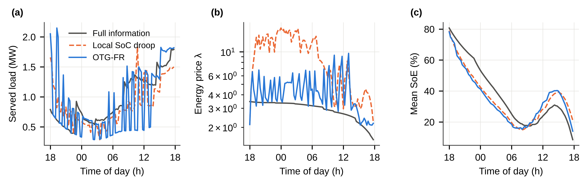

# Abstract {.unnumbered}

When a storm takes down the bulk grid, parts of a distribution feeder can be kept alive as islands supplied by local batteries and solar panels. The same storm usually cuts the communication links needed to coordinate them, so each zone serves only what its own battery can carry. We show that the island does not need those links. Inverters running in grid-forming mode with frequency droop all settle to one frequency, and that frequency is a weighted sum of every inverter's power set-point. The electrical network therefore already performs the averaging step that federated learning and price-based coordination require. We exploit this with ratio-coded droop aggregation: each zone adds a few kilowatts of Walsh-coded pilot power to its set-point, and every zone recovers island-wide weighted averages from its own frequency reading as the ratio of two code correlations. The ratio cancels the unknown network, losses and droop gains. On top of this, an over-the-grid restoration algorithm lets zones learn how re-energized load surges, pool that knowledge and agree on a shared energy price without any communication link or server. On an islanded IEEE 33-bus feeder simulated with full alternating-current droop power flow, aggregates were recovered with a root-mean-square error of 0.09 on a unit scale while adding about 0.13 Hz of frequency deviation. In 100 simulated 24-hour restorations the method delivered 96.7% of the priority-weighted energy of an ideal coordinator and 99.9% of critical-load energy, compared with 77.2% and 84.9% for the best existing communication-free scheme.

**Keywords** Grid-forming inverter · Service restoration · Federated learning · Droop control · Over-the-air computation · Distribution system resilience

# Introduction

## Motivation

Inverter-based resources can now form and hold their own voltage and frequency, which means a distribution feeder no longer needs the substation to stay energized [#lasseter, #kroposki, #rocabert]. This matters most after a hurricane, wildfire or ice storm. Once the bulk grid is lost, a feeder can be split into microgrids that restore critical loads from local batteries and photovoltaic (PV) generation hours or days before transmission is repaired [#panteli, #chen, #wangz]. Planning studies on practical feeders support this: forming microgrids with distributed energy resources (DERs) and electric-vehicle batteries [#yuvaraj], building prosumer-centric microgrids for extreme weather [#thirumalai], and dispatching DER-based virtual power plants under event uncertainty [#suresh] all improve resilience. An island is only as useful as its coordination, though. The hospital in one zone may need energy stored in another zone, re-energized load draws a cold-load pick-up (CLPU) surge that has to be anticipated [#ihara], and the limited overnight energy has to go to the most important customers first.

Today that coordination comes from a distribution management system (DMS) that exchanges data with every zone over a telecommunication network. Those networks are rarely available when they are needed. During the 2017 Atlantic hurricane season, more than 95% of cell sites in Puerto Rico were reported out of service [#fcc], and the islands formed in such events have to operate without them.

## Related work and research gap

The planning studies in [#yuvaraj, #thirumalai, #suresh] decide centrally where microgrids and DERs should be placed and assume that dispatch commands can reach them. Federated learning (FL) [#mcmahan, #kairouz] keeps raw data local, but it still needs a network to carry model updates to a server. Schemes that need no communication, such as state-of-charge (SoC)-adaptive droop [#lu, #lee] and frequency-based load shedding, share *instantaneous power* between units. They cannot share *forecasts or learned quantities*: how much energy the solar park will produce tomorrow morning, or how large the surge will be when a block of load is reconnected. In direct-current microgrids, "power talk" sends bits by modulating droop set-points [#angj]. That is a slow communication channel; it does not compute aggregates and has not been applied to alternating-current (AC) restoration. Over-the-air computation [#zhu, #yang] does compute aggregates, but over radio links, which are exactly what fails in a disaster. As Table 1 shows, none of these approaches computes federated aggregates over the power network itself.

: **Table 1** Positioning of this work against representative coordination approaches

| Approach | Needs telecom | Shares forecasts or learned models | Computes aggregates | Invariant to unknown network | Round time versus number of zones *N* |
|---|---|---|---|---|---|
| Centralized microgrid formation and DER planning [#chen, #wangz, #yuvaraj, #thirumalai, #suresh] | Yes | Yes | At server | Not applicable | Grows with *N* |
| Federated learning [#mcmahan, #kairouz] | Yes | Yes | At server | Not applicable | Grows with *N* |
| Over-the-air federated learning [#zhu, #yang] | Wireless | Yes | Yes (radio) | Needs channel estimation | Constant |
| SoC-adaptive droop [#lu, #lee] | No | No | No | Yes | Not applicable |
| Power talk in DC microgrids [#angj] | No | Bits only | No | Needs channel model | Grows with *N* |
| **Proposed OTG-FR** | **No** | **Yes** | **Yes (power network)** | **Yes (ratio decoding)** | **Constant** |

## Contributions

This paper makes four contributions.

1. *Concept.* We show that the droop steady state of an AC island behaves as an analogue computer for weighted sums. The network can therefore play the role of the aggregation server in a federated algorithm, much as the radio channel does in over-the-air computation.
2. *Ratio-coded droop aggregation (RCD).* Zones transmit on orthogonal, zero-mean Walsh codes and decode each average as a ratio of two correlations. The ratio removes the unknown total droop stiffness, network losses and pilot amplitude, and the zero-mean codes reject slow load drift. A simple amplitude rule keeps the frequency deviation bounded without any communication.
3. *Over-the-grid federated restoration (OTG-FR).* Zones plan restoration over a receding horizon, pool their CLPU estimates while keeping a personalized local model, and converge on a common energy price, all through the island frequency.
4. *Validation.* We test the method with Newton AC droop power flow at every code chip, a small-signal model of the inverter dynamics, and 100 paired 24-hour restorations against four baselines and a range of telecom availabilities, and we report scaling, robustness, ablation and privacy results.

The system model is set out in Section 2 and the algorithms in Section 3. Section 4 describes the simulation setup, Section 5 presents the results, Section 6 discusses practical issues and limitations, and Section 7 concludes the paper.

# System Model

The symbols used throughout the paper are listed in Table 2.

: **Table 2** Nomenclature

| Symbol | Description | Symbol | Description |
|---|---|---|---|
| $N$, $k$ | Number of zones, zone index | $\mathbf{c}_m$, $c_m(t)$ | Walsh code $m$ and its value at chip $t$ |
| $\mathcal{B}$, $n$ | Bus set, number of buses | $L$, $T_c$ | Code length (chips), chip duration (s) |
| $\mathbf{Y}$ | Bus admittance matrix | $A$, $A_{\max}$ | Pilot amplitude per code, its cap (MW) |
| $P_k^{\mathrm{r}}$, $E_k$ | Rated power (MW), energy capacity (MWh) of zone $k$ | $p_k(t)$ | Pilot power of zone $k$ at chip $t$ (MW) |
| $\mathrm{SoE}_k$ | State of energy of zone $k$ | $z_{k,m}$ | Normalized coefficient of zone $k$ on code $m$ |
| $P_k$, $P_k^{\mathrm{set}}$ | Inverter output and droop set-point (MW) | $y_m$ | Correlation of frequency with code $m$ |
| $D_k$, $m_p$ | Droop stiffness, droop coefficient | $x_k$, $w_k$, $s$ | Statistic, weight and scale of a quantity |
| $V_k$, $V_0$, $n_{q,k}$ | Voltage, no-load voltage, Q–V droop slope | $\hat{x}$ | Decoded island-wide weighted average |
| $\omega_0$, $\Delta\omega$, $\Delta f$ | Nominal angular frequency, deviation (p.u.), deviation (Hz) | $\Delta f^\star$, $\Delta f_{\mathrm{pk}}$ | Target and observed peak excursion (Hz) |
| $P_{\mathrm{L}}$, $P_{\mathrm{PV}}$, $P_{\mathrm{loss}}$ | Island load, PV output, losses (MW) | $\lambda_k$, $\eta$ | Energy price held by zone $k$, price step |
| $b$, $p_b$, $g(t)$ | Load block, nominal demand, diurnal profile | $S_k(h)$, $E_{\mathrm{cap}}$ | Energy surplus at horizon $h$, island capacity |
| $w_b$, $\omega_b$ | Priority class weight, social priority index | $V_b$, $E_b$, $\rho_b$ | Priority value, predicted energy, re-interruption penalty |
| $m$, $\tau$, $T_d$ | CLPU magnitude, decay constant, saturation constant | $h_k$, $r_k$, $\varphi$ | Head-room, pick-up request, power share |
| $a_b$, $d_b$ | Age since re-energization, outage duration (h) | $\mu_k$, $\Lambda_k$, $\Lambda_0$ | Likelihood mean, precision, prior precision |
| $x_{b,t}$ | Energization decision of block $b$ at step $t$ | $\kappa$, $\hat{\theta}_k$ | Fusion weight, personalized CLPU estimate |
| $T$, $\Delta t$, $R$ | Horizon steps, step length, rounds per step | $\sigma$ | Standard deviation of privacy dither |

## Islanded network and grid-forming inverters

An islanded distribution network with bus set $\mathcal{B}$, $|\mathcal{B}|=n$, and admittance matrix $\mathbf{Y}$ is partitioned into $N$ restoration zones (Fig. 1). Zone $k$ owns a grid-forming (GFM) battery energy storage system (BESS) inverter with rated power $P_k^{\mathrm{r}}$, energy capacity $E_k$ and state of energy $\mathrm{SoE}_k$, together with co-located PV generation. Each GFM inverter obeys P–f and Q–V droop [#simpson, #guerrero]:

$$\omega_k=\omega_0-\frac{1}{D_k}\left(P_k-P_k^{\mathrm{set}}\right),\qquad V_k=V_0-n_{q,k}Q_k \qquad\qquad (1)$$

where $D_k=P_k^{\mathrm{r}}/m_p$ is the droop stiffness, optionally scaled by $\mathrm{SoE}_k$ under SoC-adaptive droop.

## The droop steady state is a weighted sum

In steady state all inverters share a common frequency deviation $\Delta\omega$. Summing (1) over $k$ and using the power balance $\sum_k P_k=P_{\mathrm{L}}-P_{\mathrm{PV}}+P_{\mathrm{loss}}$ gives

$$\Delta\omega=\frac{\sum_{k=1}^{N}P_k^{\mathrm{set}}+P_{\mathrm{PV}}-P_{\mathrm{L}}-P_{\mathrm{loss}}}{\sum_{k=1}^{N}D_k} \qquad\qquad (2)$$

Equation (2) is the basis of this work. The frequency that *every* zone measures locally is a *sum over all zones* of their set-points divided by an unknown common factor [#zhao, #dorfler]. If each zone adds a small pilot $p_k(t)$ to $P_k^{\mathrm{set}}$, the island physically forms $\sum_k p_k(t)$, which is exactly the operation performed by a federated-learning server.

## Load and cold-load pick-up model

Each loaded bus is a switchable load block $b$ with nominal demand $p_b$, priority class weight $w_b\in\{10,3,1\}$ (critical, essential, normal) and social priority index $\omega_b=w_b(1+0.2u_b)$, $u_b\sim U(0,1)$. When block $b$ is re-energized after an outage of duration $d_b$, its demand follows the physically based CLPU model [#ihara]

$$p_b(t)=p_b\,g(t)\left[1+(m_{\mathrm{eff},b}-1)\,\mathrm{e}^{-a_b(t)/\tau}\right],\qquad m_{\mathrm{eff},b}=1+(m-1)\left(1-\mathrm{e}^{-d_b/T_d}\right) \qquad\qquad (3)$$

where $T_d=3$ h. The parameters $(m,\tau)$ are unknown and differ slightly between zones.

## Restoration problem

Over a horizon of $T$ steps of length $\Delta t$, the island maximizes priority-weighted served energy

$$\max_{x_{b,t}\in\{0,1\}}\ \sum_{t=1}^{T}\sum_{b}\omega_b\,p_b\,g(t)\,\Delta t\;x_{b,t} \qquad\qquad (4)$$

subject to the joint island energy constraint (battery plus PV over all zones), the inverter power constraint and the CLPU dynamics (3). Because energy is shared physically through droop, the constraints couple all zones, yet the zones cannot exchange messages.

# Proposed Method

Fig. 2 shows the architecture. Every zone runs the same two algorithms: Algorithm 1 (OTG-FR) makes restoration decisions and calls Algorithm 2 (RCD) whenever island-wide quantities are needed.

![**Fig. 2** Architecture of over-the-grid federated restoration. Each zone learns from its own telemetry, encodes its statistics on orthogonal Walsh codes and superimposes them as small power pilots on the droop set-point of its grid-forming inverter (solid arrows); the island frequency, which every zone reads locally (dashed arrows), is the stiffness-normalized sum of all pilots; every zone decodes the same island-wide quantities and updates its price, cold-load pick-up model and pick-up decisions](../results/figures/Fig2.png)

## Over-the-grid federated restoration (Algorithm 1)

OTG-FR is a receding-horizon dual-decomposition scheme in which every exchange is an RCD round.

*Local planning at price $\lambda$.* For block $b$ in zone $k$, let $V_b=\omega_b\sum_{t'\ge t}p_bg(t')\Delta t$ be its nominal priority value over the remaining horizon and $E_b$ its predicted energy including CLPU (3) with the zone's current estimate $\hat\theta_k=(\hat m_k,\hat\tau_k)$. An off block is energized if $V_b\ge\lambda E_b$. When the island is perceived to be in energy deficit, an energized block is kept only if $V_b+\rho_b\ge\lambda E_b$, where $\rho_b=\omega_bp_b\cdot 8$ h penalizes re-interruption (a no-regret rule).

*Island coupling.* Each zone computes its capped energy-surplus trajectory $S_k(h)$ (battery plus forecast PV minus planned load) at horizons $h\in\{2,6,10,14,24\}$ h. The island constraint is $\min_h\sum_k S_k(h)\ge 0.05E_{\mathrm{cap}}$. RCD returns $\bar S(h)=N^{-1}\sum_kS_k(h)$, and each zone updates its own copy of the price:

$$\lambda_k\leftarrow\lambda_k\exp\!\left(\operatorname{clip}\!\left(-\eta\,\frac{N\min_h\bar S(h)-0.05E_{\mathrm{cap}}}{E_{\mathrm{cap}}},\,-0.25,\,0.25\right)\right) \qquad\qquad (5)$$

*Federated CLPU learning with partial personalization.* Each zone maintains a grid likelihood $\ell_k(m,\tau)$ from its own telemetry and reports the likelihood-only mean $\mu_k$ and precision $\Lambda_k$, weighted by $\Lambda_k/(\Lambda_k+\Lambda_0)$ so that the prior is never double-counted. It then forms

$$\hat\theta_k=\frac{\Lambda_0\mu_0+\Lambda_k\mu_k+\kappa\Lambda_{-k}\hat\mu_{\mathrm{pop}}}{\Lambda_0+\Lambda_k+\kappa\Lambda_{-k}},\qquad \kappa=0.5 \qquad\qquad (6)$$

*Power sharing.* Head-room $h_k$ and pick-up requests $r_k$ (including the CLPU peak) are also averaged by RCD, and each zone picks up blocks in priority order within the fraction $\varphi=\min(1,\bar h/\bar r)$ of its request. The complete procedure is given in Algorithm 1.

: **Algorithm 1** Over-the-grid federated restoration (OTG-FR), executed by every zone $k$ at each step $t$

| |
|:---|
| **Input:** local telemetry; block states (on or off, age, outage duration); $\mathrm{SoE}_k$; PV forecast; price $\lambda_k$; likelihood $\ell_k$ |
| **Output:** energize, keep or shed decision for every block of zone $k$ |
| 1: Update $\ell_k(m,\tau)$ with the latest measured zone demand using (3); compute $(\mu_k,\Lambda_k)$ and the local estimate $\hat\theta_k$ |
| 2: **for** round $r=1,\dots,R$ **do** |
| 3: &nbsp;&nbsp;&nbsp;Plan at $\lambda_k$ with $\hat\theta_k$: wanted blocks, surplus $S_k(h)$, head-room $h_k$, request $r_k$ |
| 4: &nbsp;&nbsp;&nbsp;Call **Algorithm 2** on $\{S_k(h)\}_h$, $h_k$, $r_k$, $(\mu_k,\Lambda_k)$ to obtain $\bar S(h)$, $\bar h$, $\bar r$, $\hat\mu_{\mathrm{pop}}$, $\bar\Lambda$ |
| 5: &nbsp;&nbsp;&nbsp;Update $\lambda_k$ by (5); set the deficit flag if the island gap is negative |
| 6: &nbsp;&nbsp;&nbsp;Update the personalized CLPU estimate $\hat\theta_k$ by (6) |
| 7: **end for** |
| 8: Re-plan at the final $\lambda_k$; shed blocks that fail the keep test (only in deficit) |
| 9: Energize wanted blocks in descending $\omega_b$ within the power share $\varphi\,r_k$ |
| 10: Inverters share the net load physically by droop; protection trips the lowest-priority blocks if inverter power is insufficient |

## Ratio-coded droop aggregation (Algorithm 2)

Let $\mathbf{c}_m\in\{\pm1\}^L$, $m=0,\dots,M$, be rows of an $L\times L$ Hadamard matrix with the constant row excluded; they are zero-mean, $\sum_t c_m(t)=0$, and orthogonal, $\mathbf{c}_m^{\top}\mathbf{c}_{m'}=L\,\delta_{mm'}$. The highest-sequency rows are selected to reject slow drift. Zone $k$ maps its statistics to normalized coefficients $z_{k,m}\in[-1,1]$ and injects

$$p_k(t)=A\sum_{m}z_{k,m}\,c_m(t),\qquad t=1,\dots,L \qquad\qquad (7)$$

By (2), every zone measures $\Delta\omega(t)=\big(\sum_k p_k(t)+\Delta P_{\mathrm{base}}(t)\big)/\sum_k D_k$, and correlating with code $m$ gives

$$y_m=\frac{1}{L}\sum_{t=1}^{L}c_m(t)\,\Delta\omega(t)=\frac{A}{\sum_k D_k}\sum_{k}z_{k,m}+\varepsilon_m \qquad\qquad (8)$$

where $\varepsilon_m$ collects load fluctuations and measurement noise attenuated by the processing gain $L$; a constant imbalance is removed exactly because the codes are zero-mean. For a weighted quantity, zone $k$ sends $z_{k,\mathrm{num}}=\tilde w_k\tilde x_k$ and $z_{k,\mathrm{den}}=\tilde w_k$ on two codes, and the ratio

$$\hat{x}=s\,\frac{y_{\mathrm{num}}}{y_{\mathrm{den}}}=\frac{\sum_k w_k x_k}{\sum_k w_k} \qquad\qquad (9)$$

cancels $A/\sum_k D_k$; it is therefore invariant to the unknown network, losses, SoC-adaptive gains and inverter trips. Unweighted averages share a common code with $z_{k,\mathrm{ones}}=\tfrac12$.

*Self-normalizing amplitude.* All zones observe the same peak excursion $\Delta f_{\mathrm{pk}}$, and each updates

$$A\leftarrow \min\!\left(A_{\max},\,A\cdot 2^{\,\mathrm{round}\left(4\log_2(\Delta f^\star/\Delta f_{\mathrm{pk}})\right)/4}\right) \qquad\qquad (10)$$

so that all zones apply the same quantized gain and (9) remains exact. The procedure is given in Algorithm 2.

: **Algorithm 2** Ratio-coded droop aggregation (RCD), executed simultaneously by every zone $k$

| |
|:---|
| **Offline (before the event):** agree on code length $L$, chip duration $T_c$, the ordered list of quantities and the allocation of numerator, denominator and common codes |
| **Input:** local statistics $x_k$, weights $w_k$, scales $s$, current amplitude $A$ |
| **Output:** island-wide estimates $\hat x$ of every quantity (identical at all zones up to noise) |
| 1: Hold secondary frequency control for the round (sample and hold) |
| 2: Normalize: $z_{k,\mathrm{num}}\leftarrow \tilde w_k\tilde x_k$, $z_{k,\mathrm{den}}\leftarrow\tilde w_k$, $z_{k,\mathrm{ones}}\leftarrow \tfrac12$; optionally add dither $\mathcal N(0,\sigma^2)$ |
| 3: **for** $t=1,\dots,L$ **do** |
| 4: &nbsp;&nbsp;&nbsp;Set the droop set-point to $P_k^{\mathrm{set}}+A\sum_m z_{k,m}c_m(t)$ with a raised-cosine transition over the first 25% of the chip |
| 5: &nbsp;&nbsp;&nbsp;Average the inverter's own frequency over the second half of the chip to obtain $\Delta\omega_k(t)$ |
| 6: **end for** |
| 7: Correlate: $y_m\leftarrow L^{-1}\sum_t c_m(t)\Delta\omega_k(t)$ for every code $m$ |
| 8: Decode by ratio: $\hat x\leftarrow s\,y_{\mathrm{num}}/y_{\mathrm{den}}$ using (9) |
| 9: Update the amplitude from the observed peak excursion using (10) |
| 10: **return** $\{\hat x\}$ |

## Properties

*Invariance.* By (8) and (9), the decoded value does not depend on $\sum_kD_k$, losses, network topology or a common amplitude; unit tests verify exact recovery for arbitrary stiffness and constant imbalance.

*Scalability.* All zones transmit simultaneously, so the round length $L\,T_c$ is independent of $N$, whereas a polled telecom protocol needs $N$ slots.

*Information exposure.* Only the superposition $\sum_k p_k(t)$ exists on the physical channel, and no per-zone message is ever formed. This structural property resembles secure aggregation [#bonawitz]; formal differential privacy is quantified in Section 5.5.

# Experimental Setup

## Test system

The IEEE 33-bus feeder [#baran] (12.66 kV, 3.715 MW and 2.3 Mvar peak; data from pandapower [#thurner]) loses its substation, and tie lines 18–33 and 25–29 are closed to mesh the island (Fig. 1). Table 3 lists the four zones. Total resources of 3.8 MW and 14 MWh of storage and 3.2 MW of PV are deliberately scarce overnight so that prioritization matters: Zone 1 contains a hospital but little storage, whereas Zone 3 is a lightly loaded solar-storage park.

: **Table 3** Zones and distributed energy resources of the test system (bus numbers as in Fig. 1)

| Zone | Buses | GFM bus | BESS (MW / MWh) | PV (MW) | Critical and essential loads |
|---|---|---|---|---|---|
| 1 (urban core) | 1–5, 19–25 | 3 | 0.6 / 2.0 | 0.3 | Hospital (bus 4); transit hub (bus 24) |
| 2 (civic) | 6–13 | 8 | 0.8 / 2.5 | 0.4 | Emergency shelter (bus 7) |
| 3 (solar park) | 14–18 | 16 | 1.6 / 7.0 | 2.0 | None |
| 4 (utilities) | 26–33 | 30 | 0.8 / 2.5 | 0.5 | Water pumping (bus 30); waste water (bus 32) |

## Simulation layers

1. *AC channel validation.* For every 1-s chip a Newton islanded droop power flow [#mumtaz] is solved with all voltage magnitudes, all angles but one and the common $\Delta\omega$ as unknowns and an analytic Jacobian. Load fluctuates independently at every bus (0.5% of island load per chip) with slow drift; SoC-adaptive droop gains are random and undisclosed; measurement noise is 1 mHz.
2. *Time-domain dynamics.* A small-signal GFM model with a 0.05-s power-measurement filter and 0.15 p.u. coupling reactance is coupled through the Kron-reduced island and discretized exactly; the chip duration is swept.
3. *Closed-loop restoration.* A 24-hour window starting at 18:00 with 15-min steps and 100 Monte Carlo scenarios. RCD uses the linear channel validated against AC power flow, and every step is checked with the full AC droop power flow.
4. *Scaling and robustness.* The number of zones is varied from 4 to 64, an inverter is tripped mid-round, and differential privacy is accounted.

## Scenarios and baselines

Each scenario draws the CLPU parameters $m\sim U(1.5,2.8)$ and $\tau\sim U(0.5,2.5)$ h with zone deviations of 5% and 10%; a day type (clear, partly cloudy or overcast with probabilities 0.4, 0.4 and 0.2) with zone-correlated clouds; 15% PV forecast error; 3% load noise; 2% telemetry noise; and initial $\mathrm{SoE}\sim U(0.7,0.95)$. The outage starts 2 h before the window, and all methods see identical realizations (paired design).

The baselines are (i) a *full-information* coordinator with perfect communication, true CLPU, perfect PV forecasts and exact bisection on $\lambda$; (ii) *local planning with rating-proportional droop*; (iii) *local planning with SoC-adaptive droop*, the strongest communication-free practice [#lu, #lee]; and (iv) *telecom FL*, the identical planner exchanging aggregates over links that follow two-state Markov outages with availability $p$ and a mean outage of 2 h. The parameters are listed in Table 4.

: **Table 4** Main simulation parameters

| Parameter | Value | Parameter | Value |
|---|---|---|---|
| P–f droop coefficient $m_p$ | 2% | Q–V droop $n_q$, no-load voltage $V_0$ | 5%, 1.03 p.u. |
| Code length $L$, chip duration $T_c$ | 128, 1 s | Rounds per step $R$ | 3 |
| Initial and maximum amplitude $A$, $A_{\max}$ | 6 kW, 15 kW per code | Target excursion $\Delta f^\star$ | 0.1 Hz |
| Price step $\eta$, trust region | 1.0, ±0.25 (logarithmic) | Re-interruption penalty $\rho_b$ | 8 h of service |
| Energy reserve | 5% of capacity | CLPU fusion weight $\kappa$ | 0.5 |
| Battery efficiency, minimum SoE | 0.95, 5% | Step $\Delta t$, horizon | 15 min, 24 h |

## Metrics and implementation

The metrics are the priority-weighted served energy relative to full information (PWES), the share of critical-load energy served, block re-interruptions per day, under-frequency load-shedding (UFLS) trips, the AC voltage range and the pilot-induced frequency excursion. Comparisons use the paired Wilcoxon signed-rank test with 95% confidence intervals. The implementation uses Python 3 with NumPy, SciPy and pandapower [#thurner]; a complete reproduction takes about 4 min on four processor cores, and eleven unit tests check power balance, droop sharing and the exactness and invariance of the decoding. The complete code and result files are provided as Online Resource 1.

## Use of generative artificial intelligence

A large language model (Claude, Anthropic) was used to assist in implementing the simulation code, generating figures and drafting the manuscript text. The authors designed and verified the study, checked all code, results and references, and take full responsibility for the content.

# Results

## Validation of the droop channel

Table 5 and Fig. 3 show that the AC island computes weighted averages. With a 10-kW pilot and 64 chips, the root-mean-square error (RMSE) is 0.089 for the unweighted mean and 0.086 for the precision-weighted mean on a ±1 scale, and every zone obtains the same estimate. The linear channel used in the closed loop reproduces the AC frequency within 0.19 mHz RMS.

: **Table 5** Validation of RCD in full AC power flow (64 chips, 60 rounds per amplitude)

| Pilot amplitude per code | RMSE, mean | RMSE, weighted mean | Linear versus AC frequency (mHz RMS) | Maximum pilot excursion (mHz) |
|---|---|---|---|---|
| 2 kW | 1.131 | 0.860 | 0.14 | 9.1 |
| 5 kW | 0.167 | 0.206 | 0.15 | 29.7 |
| 10 kW | 0.089 | 0.086 | 0.19 | 53.6 |
| 20 kW | 0.042 | 0.046 | 0.29 | 104.3 |

The error follows the processing gain and falls from 0.18 at 16 chips to 0.040 at 256 chips (Table 6). In the time domain, the slowest electromechanical mode has a 0.10-s time constant and a damping ratio of at least 0.33, and 1-s chips add only 1.8×10⁻⁴ decoding error and a 59-mHz peak excursion (Table 7).

: **Table 6** Decoding RMSE versus code length and chip-level load noise (10 kW pilot, 400 rounds each)

| Code length *L* | 16 | 32 | 64 | 128 | 256 |
|---|---|---|---|---|---|
| RMSE (mean) | 0.181 | 0.105 | 0.072 | 0.057 | 0.040 |
| **Load noise (σ / load)** | **0.25%** | **0.5%** | **1%** | **2%** | |
| RMSE (mean), *L* = 64 | 0.041 | 0.082 | 0.147 | 0.582 | |

: **Table 7** Effect of inverter dynamics versus chip duration with raised-cosine chips

| Chip duration (s) | 0.05 | 0.1 | 0.2 | 0.5 | 1.0 |
|---|---|---|---|---|---|
| Transient-induced RMSE | 1.20 | 1.53 | 0.149 | 7.0×10⁻³ | 1.8×10⁻⁴ |
| Peak frequency excursion (mHz) | 452 | 189 | 126 | 57 | 59 |

## Closed-loop restoration performance

Table 8 and Fig. 4 summarize the 100 paired scenarios. OTG-FR delivers 96.7% (95% CI 96.4–97.0) of the full-information PWES and serves 99.9% of critical-load energy, whereas local SoC-adaptive droop reaches 77.2% and 84.9% and rating droop 73.6% and 80.1%. OTG-FR outperforms local SoC droop in all 100 scenarios (Wilcoxon $p=3.9\times10^{-18}$), and voltages remained within 0.978–1.036 p.u. in every AC check.

: **Table 8** Closed-loop restoration over 100 scenarios (mean values; 95% confidence interval for PWES)

| Method | Telecom | PWES (% of full information) | Critical energy served (%) | Energy served (MWh) | Re-interruptions per day | UFLS trips per day | Minimum voltage (p.u.) |
|---|---|---|---|---|---|---|---|
| Full information (reference) | Perfect | 100.0 | 100.0 | 24.88 | 1.8 | 0.00 | 1.005 |
| Local, rating droop | None | 73.6 [72.3, 74.9] | 80.1 | 21.85 | 43.7 | 0.00 | 1.008 |
| Local, SoC droop | None | 77.2 [75.9, 78.5] | 84.9 | 22.28 | 45.0 | 0.00 | 1.008 |
| Telecom FL, *p* = 0.50 | 50% | 78.0 [76.7, 79.4] | 83.0 | 24.14 | 49.3 | 0.92 | 1.001 |
| Telecom FL, *p* = 0.75 | 75% | 80.8 [79.4, 82.2] | 84.3 | 24.58 | 47.2 | 1.55 | 1.001 |
| Telecom FL, *p* = 0.90 | 90% | 87.9 [86.4, 89.3] | 89.7 | 24.85 | 57.2 | 2.87 | 1.001 |
| Telecom FL, *p* = 1.00 | 100% | 99.9 [99.7, 100.1] | 99.8 | 24.96 | 59.4 | 2.60 | 1.000 |
| **OTG-FR (proposed)** | **None** | **96.7 [96.4, 97.0]** | **99.9** | **24.00** | **39.1** | **0.17** | **0.998** |

Fig. 5 explains the gain for one scenario. Under local planning the urban core rations its hospital supply to its own small battery while the solar park restores ordinary customers; under OTG-FR the island-wide price redirects that energy, and the learned scarcity price tracks the full-information price far more closely.

## Value of the grid as a channel

Exchanging the same information over a perfect network reaches 99.9%, so the 3.2-point gap to OTG-FR is the cost of a noisy analogue channel. That advantage of telecom vanishes at realistic availability: at $p=0.9$ telecom FL reaches 87.9% and suffers 2.9 UFLS trips per day because zones act on stale or extrapolated aggregates, and at $p\le0.5$ it is no better than local planning. OTG-FR outperforms telecom FL at $p=0.9$ in 87 of 100 scenarios ($p=2.8\times10^{-15}$) without any communication infrastructure (Fig. 4c).

## Robustness, scaling and ablation

Table 9 shows graceful degradation. Doubling and quadrupling the chip-level load noise lowers PWES to 95.3% and 92.6% while critical-load service stays at or above 99.8%, and halving the code length costs 0.3 points. The decoding error is flat from 4 to 64 zones (mean absolute error, MAE, 0.072–0.076) at a constant 128-s round, whereas a polled protocol grows linearly with $N$ (Fig. 6). When an inverter trips mid-round and removes 30% of the island stiffness, ratio decoding keeps the MAE at 0.12, whereas naive decoding with an assumed stiffness degrades to 0.16. Ablating federated CLPU fusion raises the error of the learned CLPU magnitude by 71% (0.055 to 0.094) but leaves PWES essentially unchanged (96.6% versus 96.7%, $p=0.77$), so in this setting the dominant benefit comes from sharing energy scarcity rather than load models.

: **Table 9** Robustness and ablation of OTG-FR over 100 scenarios

| Variant | PWES (%) | Critical served (%) | Re-interruptions per day | Mean pilot excursion (mHz) | CLPU magnitude error |
|---|---|---|---|---|---|
| OTG-FR (default) | 96.7 | 99.9 | 39.1 | 128 | 0.055 |
| Load noise 1% per chip | 95.3 | 99.9 | 42.3 | 124 | 0.063 |
| Load noise 2% per chip | 92.6 | 99.8 | 49.5 | 120 | 0.081 |
| Code length 64 | 96.4 | 99.9 | 33.9 | 129 | 0.061 |
| Without federated CLPU fusion | 96.6 | 99.9 | 37.1 | 128 | 0.094 |
| Dither σ = 0.05 | 96.0 | 99.9 | 41.1 | 129 | 0.057 |
| Dither σ = 0.10 | 94.4 | 99.7 | 42.6 | 133 | 0.058 |
| Dither σ = 0.20 | 90.2 | 98.7 | 40.1 | 149 | 0.069 |

## Privacy

No per-zone signal exists on the channel: an observer at any socket sees only aggregates, and a participating zone learns only the sum of the other zones' statistics, which reveals nothing individual for $N\ge3$. Gaussian dither on the pilots costs 0.7, 2.3 and 6.5 PWES points at σ = 0.05, 0.1 and 0.2 (Table 9). Zero-concentrated differential privacy [#dwork, #bun], however, yields ε ≈ 4×10³ over 288 rounds at σ = 0.2 (δ = 10⁻⁵), so formal differential privacy at usable noise levels is weak, and only the structural property is claimed.

# Discussion

Coordinating distributed energy resources is usually treated as a communication problem, to be solved with more bandwidth, sturdier links and better cybersecurity. Our results point to a different option for the restoration case. In an island run by grid-forming inverters, every unit already writes to a shared medium through its power set-point and reads from it through its frequency, and the steady state of that medium is a weighted sum. That is the operation federated learning and dual decomposition rely on. The island can therefore coordinate itself during the hours when coordination matters most and telecommunication is least likely to work. Nothing new has to be installed: the inverters need firmware that applies the codes, correlates the frequency and takes a ratio. OTG-FR also fits alongside the planning methods of [#yuvaraj, #thirumalai, #suresh]. Those methods decide where microgrids and DERs should go; OTG-FR decides how to use them once an island has formed and the communication links are down.

Several practical points need attention before deployment. The pilots add about 0.13 Hz of frequency deviation, which is well inside the continuous-operation range of IEEE Std 1547-2018 [#ieee1547], but protection settings for anti-islanding and under-frequency tripping, and any synchronous machines still connected, must be checked against it. Secondary frequency control has to be paused for each 128-s round. The codes and the list of shared quantities must also be agreed in advance, for example as part of the utility's restoration plan.

The study has limitations. All results come from simulation. The channel model was checked against AC power flow and inverter dynamics, but the closed-loop study used that validated linear model on a single feeder with assumed load priorities. OTG-FR also switches loads off and on again more often than the ideal coordinator (39 re-interruptions per day against 1.8), although less often than local planning (45) or telecom-based federation (57–59). This comes from the small number of price updates that fit in each 15-min step, and a pricing rule that penalizes switching should reduce it. A faulty or malicious zone could inject biased pilots; authenticating zones and making the aggregation robust to outliers remain open problems, as they are for over-the-air federated learning [#yang]. Formal differential privacy would require more dither than we found practical, or secure aggregation across rounds. Next steps are hardware-in-the-loop tests with commercial grid-forming controllers on a real-time simulator, measurement of frequency noise under recorded load, unbalanced three-phase feeders, and other uses of the channel such as distributed state estimation and federated forecasting.

# Conclusion

In an island supplied by droop-controlled grid-forming inverters, the common frequency is a weighted sum of all inverter set-points, so the power network itself can act as the aggregation server for federated algorithms. Ratio-coded droop aggregation turns this into a usable channel: the decoded averages do not depend on the unknown network or droop gains, and the frequency deviation stays bounded without any communication. Over-the-grid federated restoration uses the channel to coordinate priority-based restoration with no telecom link, no server and no per-zone message. On an islanded IEEE 33-bus feeder it recovered 96.7% of the ideal restoration value and 99.9% of critical-load energy, compared with 77.2% and 84.9% for the best communication-free scheme, and a telecom-based version of the same algorithm needed more than about 95% link availability to do as well. The approach gives distribution operators a coordination layer that keeps working for as long as the island itself stays energized.

# Statements and Declarations {.unnumbered}

**Competing interests** The authors have no competing interests to declare that are relevant to the content of this article.

**Funding** Funding information is provided on the separate title page.

**Data availability** All data generated and analysed in this study, including scenario seeds and result files, are provided as Online Resource 1 (anonymized for review) and will be deposited in a public repository upon acceptance.

**Code availability** The complete implementation (simulation package, experiments and unit tests) is provided as Online Resource 1 and reproduces every number and figure in this article.

# References {.unnumbered}

[[REFERENCES]]
